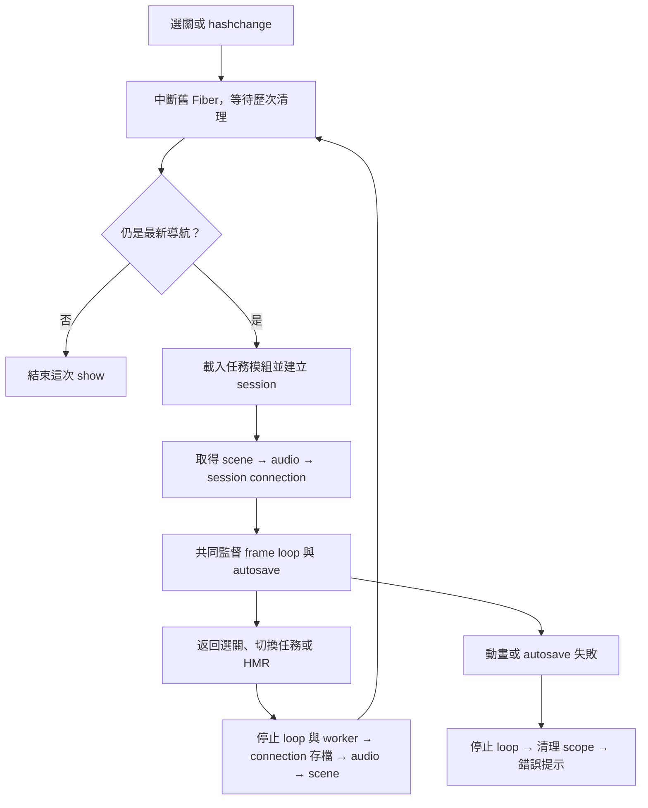

# Effect 使用盤點與採用計畫

盤點日期：2026-10-24。依據目前工作目錄與固定依賴 **Effect 4.0.5**。
本文件記錄現況、候選改造與驗證條件；**E01～E09 已推廣至全部九個任務，並完成跨任務檢查**，包含各關自動存檔排程，以及全站導航 Fiber 與 PWA 重試。原八關完整稽核見第十一批；第九關沿用與驗證另列於後方紀錄。
架構邊界見 [architecture.md](architecture.md)，官方入口為 [Effect v4 API](https://effect.website/docs/v4/api/effect)。
`Effect`、`Schema` 的官方頁面過大，這次也直接核對已安裝套件的 `src/Effect.ts`、`src/Schema.ts` 與相關實作，避免套用 v3 寫法。

目前最有價值的方向是把 Effect 延伸到**資源取得、失敗處理與瀏覽器服務邊界**。
九個任務已統一初始化失敗清理、啟動錯誤分類、動畫錯誤通道、音效解鎖、同步儲存邊界、Schema 驗證、存檔／音效服務注入與啟動追蹤。
存檔政策為**保留目前版本續玩，移除舊版相容**：版本不符、缺少必要欄位或狀態矛盾時開新局。
遊戲狀態、幾何、拖曳計算和逐幀渲染維持普通 TypeScript，保留目前可直接測試的純函式。

## 已使用的地方

`src/` 正式程式目前有 57 個檔案直接匯入 `effect`：入口、兩個 app helper、八個 runtime helper、九個任務各自的 scene／session／persistence／services／startup，以及修路的 devtools。使用 `Effect`、`Exit`、`Cause`、`Data`、`Schema`、`Result`、`Context`、`Layer`、`Fiber`、`Schedule`；測試另使用 `TestClock`。
尚未使用 `Stream` 或 `KeyValueStore`。

| 位置與符號 | 使用的 API | 現在負責的行為 |
| --- | --- | --- |
| [main.ts](../src/main.ts)：`show`／`program` | `scoped`、`gen` | 每次進入任務建立獨立 scope，依序載入模組、建立資源並連接控制器。 |
| 同上：九個任務的模組載入 | `all`，透過 `loadMissionModule` 使用 `tryPromise` | 明確以 `concurrency: 'unbounded'` 載入靜態 import 路徑；錯誤含任務、模組與原始原因。 |
| 各任務 startup.ts：session prepare／scene／connect | `initializeSession`、`initializeScene` | 分類初始化拋錯；scene 與 connect 直接加入任務 scope。 |
| 各任務 services.ts：audio 取得 | `Layer.effect`、`acquireRelease`、`sync`、`closeMissionAudio` | 全九關由 Layer 取得；離開時等待 dispose，失敗仍清理。AudioContext 延後到手勢解鎖時建立。 |
| [scene-lifecycle.ts](../src/runtime/scene-lifecycle.ts)：`acquireRenderer`／`acquireScene` | `acquireRelease`、`sync` | 共用 renderer 與場景所有權；釋放 Mesh／Line／Points 的 geometry 與 material，包括碼頭 LineSegments。 |
| 九個任務的 scene 工廠（下表） | `gen`、`acquireRelease`、`addFinalizer`、`sync` | 分別管理 renderer、scene graph、陰影、材質快取及 ResizeObserver；回傳普通 render／hit 方法，清理由 scope 負責。 |
| 九個任務的 `session.connect`（下表） | `gen`、`acquireRelease`、`addFinalizer`、`sync` | 分開登記事件群組、提示、最後存檔與取消拖曳；全部回傳等待中的 frame-loop Effect，由共用 adapter 排程／清理 rAF；救火另登記停止持續水聲。 |
| [mission-lifecycle.ts](../src/runtime/mission-lifecycle.ts) | `Data.TaggedError`、`tryPromise`、`catchDefect`、`catchTag`、`Cause.hasInterruptsOnly` | 全任務的模組／場景／session／音效關閉錯誤分類；區分正常中斷與需要診斷的失敗。 |
| [main.ts](../src/main.ts)：`program` 結尾 | `onExit`、`Exit.isSuccess`、`catchCause` | 任務直接等待 loop；scope 清理後記錄失敗，過期任務不覆蓋畫面，純取消保持安靜。 |
| [navigation.ts](../src/app/navigation.ts)：`createNavigation` | `runFork`、`scoped`、`Fiber.interrupt`／`await` | 全站選單／任務由 Fiber 管理；保留最新導航判斷、跨次取消的清理等待與 HMR 交接。 |
| [autosave.ts](../src/runtime/autosave.ts)：`withAutosave` | `Schedule.spaced`、`schedule`、`forkScoped`、`Fiber.join`、`raceFirst` | 九關按原有 700／800 ms 間隔保存；與 frame loop 共同監督，任一失敗都停止兩者，再清理 connection。 |
| [pwa.ts](../src/app/pwa.ts)：`registerWithRetry`／`startPwaRegistration` | `tryPromise`、`retry`、`Schedule.exponential`、`runFork`、`callback` | 正式建置註冊最多三次；load gate、pagehide／HMR 取消、最終失敗可選降級。 |
| [frame-loop.ts](../src/runtime/frame-loop.ts)：`runFrameLoop` | `suspend`、`callback`、`ensuring`、`Data.TaggedError` | 九個任務的 rAF 排程／回呼錯誤轉為 FrameLoopError，正常取消與失敗都停用 loop，交由入口關閉 scope。 |
| [audio-unlock.ts](../src/runtime/audio-unlock.ts)：`createAudioUnlocker` | `promise`、`flatten`、`catchTag`、`runPromiseExit`、`Data.TaggedError` | 九個任務手勢內同步啟動 unlock，立即觀察拒絕；AudioUnlockError 降級、開發診斷與 connection signal 綁定。 |
| [storage.ts](../src/runtime/storage.ts)：`createStorageBoundary`／`createStorageReporter` | `try`、`flatMap`、`catch`、`runSync`、`Data.TaggedError` | 同步包裝 storage getter／讀寫刪除、JSON 編解碼；分類失敗、開發環境去重診斷，回傳可降級結果。 |
| 九任務的 `persistence.ts`（下方版本表） | `Schema.Struct`／`Union`／`Literals`／`check`、`decodeUnknownResult`、`Result` | 驗證目前版本的型別、範圍與必要欄位；domain 檢查遊戲不變量並取消失效輸入。 |
| [snapshot.ts](../src/runtime/snapshot.ts)：`createSnapshotDecoder`／`restoreSnapshot` | `Schema.decodeUnknownResult`、`Result` | 八關共用結構驗證、domain 恢復、恢復後驗證與失敗診斷；修路保留自己的快照外層與調校參數。 |
| 九個任務的 services.ts（如下方 E07 表）：`*Persistence`／`*Audio` | `Context.Service`、`Layer.succeed`、`Layer.effect` | 注入模組生命週期的同步存檔 facade、每次任務 scope 的音效資源。 |
| 九個任務的 startup.ts（如下方 E07 表）：`prepare*Mission` | `gen`、`Layer.build`、`Context.get` | 準備 session、場景、audio 與 connection，回傳未開始的 loop；scope 所有權留給入口。 |
| [mission-startup.ts](../src/runtime/mission-startup.ts)：`createStartupDiagnostics` | `withSpan`、`onExit`、`logError`、`annotateLogs` | 九關啟動根 span／六或七個階段、開發摘要、scope 清理後的關聯錯誤紀錄。 |
| [修路 devtools.ts](../src/missions/road-repair/devtools.ts)：`restoreRoadSnapshot`／開發存取 | `Result.isSuccess` | 保留同步 facade，驗證失敗降級；開發快照以 HMR → 記憶體 → storage 的優先順序恢復。 |

全部任務的 scene、connection 都直接加入入口 scope，無須另呼叫 scene.dispose 或 connection disposer。
下表 scene 工廠及 session.connect 都回傳需要 scope 的 Effect；audio 工廠仍是普通 TypeScript。
connect 的成功值為等待中的 `Effect<never, FrameLoopError | AutosaveError>`。入口必須在初始化完成後 `yield* run`，才能啟動並共同監督動畫與各關的存檔 worker。

| 任務 | 場景取得函式 | 音效取得函式 | 控制器 |
| --- | --- | --- | --- |
| 修路 | [createScene](../src/missions/road-repair/scene.ts) | `createAudio(roadSounds)` | [createRoadSession](../src/missions/road-repair/session.ts) |
| 蓋房子 | [createHouseScene](../src/missions/house-build/scene.ts) | `createAudio(houseSounds)` | [createHouseSession](../src/missions/house-build/session.ts) |
| 救火 | [createFireScene](../src/missions/fire-rescue/scene.ts) | `createFireAudio` | [createFireSession](../src/missions/fire-rescue/session.ts) |
| 交通救援 | [createTrafficScene](../src/missions/traffic-rescue/scene.ts) | `createTrafficAudio` | [createTrafficSession](../src/missions/traffic-rescue/session.ts) |
| 警察 | [createPoliceScene](../src/missions/police-patrol/scene.ts) | `createPoliceAudio` | [createPoliceSession](../src/missions/police-patrol/session.ts) |
| 碼頭 | [createPortScene](../src/missions/port-cargo/scene.ts) | `createPortAudio` | [createPortSession](../src/missions/port-cargo/session.ts) |
| 山路 | [createMountainScene](../src/missions/mountain-clearance/scene.ts) | `createMountainAudio` | [createMountainSession](../src/missions/mountain-clearance/session.ts) |
| 轉運站 | [createTransferScene](../src/missions/passenger-transfer/scene.ts) | `createTransferAudio` | [createTransferSession](../src/missions/passenger-transfer/session.ts) |
| 清潔隊 | [createSanitationScene](../src/missions/sanitation/scene.ts) | `createSanitationAudio` | [createSanitationSession](../src/missions/sanitation/session.ts) |

### 現有生命週期



取得順序的反向清理讓控制器先停止使用場景和音效，再釋放兩者。
`createNavigation` 的 `revision` 避免過期導航繼續掛載；每次請求都保留此前的清理 Promise，即使等待中的中間請求被取消，最新請求仍等待最早的 audio close。HMR 以 `import.meta.hot.data.cleanup` 將導航與 PWA 清理 Promise 交給新模組。
從選單進入的新回合，會在舊 scope 存檔完成後才 `clearProgress`，避免舊存檔覆蓋新回合。
這些都是改造時必須保留的行為。參考 [Scope](https://effect.website/docs/v4/api/effect/Scope) 與 [Effect 原始碼（4.0.5）](https://github.com/Effect-TS/effect/blob/effect%404.0.5/packages/effect/src/Effect.ts)。

### 目前包裝沒有涵蓋的範圍

- 全部任務的 scene 工廠／`session.connect()` 已逐項登記 scope 清理；各 `create*Session()` 的準備仍是同步程式，由 prepare wrapper 分類失敗。
- 九個任務的 rAF 排程及 `animate` 內更新／render／HUD 拋錯，皆經 adapter 進入 `program` 失敗通道。九關定期存檔皆由 autosave worker 監督；rAF 仍可能觸發既有的階段轉換即時保存。pointer／click、ResizeObserver 回呼仍有各自的邊界；任務 Fiber 不是整個遊戲的全域錯誤處理。
- [pointer.ts](../src/runtime/pointer.ts)、[audio.ts](../src/runtime/audio.ts)、各任務的 `dispose()` 雖受 scope 間接管理，內部沒有匯入 Effect。
- 全部任務的正式／開發存檔、上一回合記錄與共用徽章／靜音均使用同步 storage adapter；正式與開發存檔都經 Schema 驗證。PWA 註冊納入 Effect，但原生 `serviceWorker.register()` 無法被 Fiber 中斷實際取消；Workbox 快取仍由瀏覽器管理。
- 九個任務的音效解鎖觀察工作皆接入 connection signal，但無法取消瀏覽器的 `AudioContext.resume()`。

## 候選改造與優先順序

這裡的優先級表示建議實作順序，不表示已重現使用者遇到的錯誤。

| ID | 優先級／狀態 | 建議範圍 | Effect 對應能力 | 預期收益與主要成本 |
| --- | --- | --- | --- | --- |
| E01 | 九任務已實作 | 初始化與清理的部分失敗 | `acquireRelease`、`addFinalizer` | 逐項登記資源；逐任務故障注入確認中途失敗與清理拋錯仍回收。 |
| E02 | 九任務已實作 | 載入、場景、session、音效關閉的錯誤分類 | `tryPromise`、`Data.TaggedError`、`catchDefect`、`catchTag`、`onExit` | 保留原始原因；區分正常取消，並記錄取消期間的清理失敗。 |
| E03 | 九任務已實作 | 動畫迴圈的失敗回報 | `callback`、`ensuring`、父程式直接等待 | 任務渲染、更新或排程失敗會停止 loop、清理任務並顯示錯誤提示。 |
| E04 | 九任務已實作 | 音效解鎖策略 | `promise`、`flatten`、`catchTag`、signal | 同步拋錯／非同步拒絕皆降級；保留手勢內同步啟動、合併 pending 呼叫、開發診斷與取消處理。 |
| E05 | 九任務已實作 | 正式／開發存檔、偏好、上一回合 | `try`、`catch`、`runSync` | 同步降級、記憶體優先、刪除遮蔽與去重診斷。 |
| E06 | 九任務已實作 | 正式／開發存檔驗證 | `Schema.decodeUnknownResult`、`Result` | 僅接受完整目前版本；保留部分工作、遊戲不變量與輸入取消，移除舊版遷移。 |
| E07 | 九任務已實作 | 同步存檔 facade 與 scoped 音效注入 | `Context.Service`、`Layer.effect`／`Layer.succeed` | 實際接入瀏覽器實作與隔離測試替身；保留存檔 memory／HMR 壽命、各關上一回合與偏好。 |
| E08 | 九任務已實作 | 啟動各階段、取消與錯誤診斷 | `all`、`withSpan`、`logError`、`annotateLogs` | 各關記錄分階段結果／時間與 startupId；保留並行載入、正常取消與清理後錯誤紀錄。 |
| E09 | 九任務與全站共用部分已實作 | 各關 700／800 ms autosave、PWA 最多三次註冊、導航 Fiber | `Schedule`、`forkScoped`、`Fiber`、`retry` | 定期存檔脫離 rAF、互相監督失敗；有界重試；最新導航仍等待舊清理。 |

### E01：九個任務已實作部分初始化與獨立清理

八個場景工廠都回傳需要 scope 的 Effect，保留普通 `render()`／hit 方法。
取得 renderer 後立即登記 release，再設定 renderer、掛載 canvas、建構場景。
scene graph、陰影、材質快取各有 finalizer；ResizeObserver 在 `observe(host)` 前已登記 `disconnect()`。
因此後續掛載、模型建立或 observer 設定失敗時，已取得且登記的資源仍會釋放。
第三方 constructor 在回傳資源之前的內部失敗，不是外部 scope 能自動回滾的範圍。

九個任務的 connect 同樣改為 scoped Effect。
AbortController 與拖曳提示取得後立即登記清理；取消拖曳、最後存檔各自登記 finalizer。
全部任務加入 E03 後，結束順序為「停止 frame loop → 取消拖曳 → 最後存檔 → 移除提示 → 解除監聽 → 關閉音效 → 釋放場景」。
全部任務加入 E09 後，還會先停止 autosave worker，再進入上述 connection 清理。
存檔失敗不會跳過 rAF／監聽／提示的清理，取消拖曳失敗也不會跳過後面的 finalizer。
救火在最後存檔後、移除提示前另執行 `audio.setSpraying(false)`；它本身失敗仍會解除監聽並關閉音效。

同一個 finalizer 內的多項同步釋放使用 [releaseAll](../src/runtime/cleanup.ts)：全部嘗試後才以 `AggregateError` 回報。
renderer 的 `dispose()`、`forceContextLoss()`、canvas 移除，以及 scene graph／材質快取皆採此方式。
[geometry.ts](../src/runtime/geometry.ts) 先清空快取再逐一 dispose，避免一個材質失敗阻斷其他材質；
[pointer.ts](../src/runtime/pointer.ts) 以 `finally` 釋放 capture；[drag-hint.ts](../src/runtime/drag-hint.ts) 在初始化完成後才掛載提示。
這些共用 helper 適用全部任務。

[scene-lifecycle.ts](../src/runtime/scene-lifecycle.ts) 集中 renderer 與場景圖的清理；場景圖在釋放時遍歷，涵蓋後續加入的物件。
資源以 Set 去重；碼頭的 LineSegments 及其他 Line／Points 也會釋放，不只處理 Mesh。
陰影、材質快取與 ResizeObserver 仍在各場景的取得處立即登記，保留各任務的建構差異。
[救火音效 dispose](../src/missions/fire-rescue/sounds.ts) 分別嘗試停止／斷開水聲節點及關閉 AudioContext，
其中一項失敗不跳過其餘步驟，最後以 AggregateError 保留所有原因，交由 AudioCloseError 記錄。
水聲的 source／filter／gain 分別追蹤；部分初始化失敗立即斷開已取得的節點，下一次手勢沿用同一個 context 重建。只有已啟動的 source 才呼叫 stop；回滾本身失敗時保留初始化與清理兩種原因。
參考 [acquireRelease／addFinalizer](https://effect.website/docs/v4/api/effect/Effect)。

### E02、E08：九個任務已分類錯誤並整理載入組合

[mission-lifecycle.ts](../src/runtime/mission-lifecycle.ts) 定義四個保留任務 ID 與原始 `cause` 的 tagged error：

| 錯誤 | 邊界與行為 |
| --- | --- |
| `ModuleLoadError` | `loadMissionModule` 以 `tryPromise` 包裝動態 import，另保留 module 名稱；提示檢查連線或回選關重試。 |
| `SceneInitError` | `initializeScene` 將場景初始化的同步缺陷分類；顯示場景／WebGL2 提示。 |
| `SessionInitError` | `initializeSession` 分別標記 `prepare`／`connect`；顯示操作準備失敗提示。 |
| `AudioCloseError` | `closeMissionAudio` 在 release 內以 `catchTag` 記錄並恢復，維持 release 的 `E = never`，不阻止場景清理；console 診斷拋錯也不改變原始 Exit。 |

場景與 session wrapper 使用 `catchDefect`，只分類各自初始化邊界的拋錯；原始原因仍可診斷，正常 interruption 不轉成啟動錯誤。
外層在 scope 關閉後取得完整 `Exit`；不屬於上述邊界的 defect 保留於 Cause。
`missionFailureMessage` 只略過純 interruption，帶有清理缺陷的混合 Cause 仍記錄。
[main.ts](../src/main.ts) 在檢查導航 `isCurrent()` 前記錄真正失敗，但不讓舊任務覆蓋新畫面。
全部任務均採用 typed loader／初始化 wrapper；使用共用「關卡」錯誤提示，詳細診斷仍保留具體任務 ID。

全部任務以 `Effect.all(..., { concurrency: 'unbounded' })` 組合載入。修路／救火分開載入 scene、session、sounds；其餘六個任務的音效匯出隨 session 載入。
蓋房子也由兩次循序等待改為這個明確並行組合。
靜態 import 路徑留在 main，讓 Vite 繼續分析分包；scene → audio → connect 的取得仍循序。
瀏覽器的動態 `import()` 不接受 AbortSignal，中斷 Effect 不會取消已開始的下載／模組求值；
測試確認中斷後，即使 Promise 稍後完成，也不執行後續掛載。導航的最新版本檢查仍保留。
目前沒有自動重試，也沒有宣稱載入效能提升。
九個任務均已採用 E08 的 `withSpan`／`logError`，保留任務、模組與原始原因，細節見下方。
參考 [Effect](https://effect.website/docs/v4/api/effect/Effect)、[Data](https://effect.website/docs/v4/api/effect/Data)。

### E03：九個任務已接住動畫回呼的失敗，保留 rAF 驅動

[frame-loop.ts](../src/runtime/frame-loop.ts) 的 `runFrameLoop` 以一個等待中的 Effect 持有整個動畫迴圈。
九個任務的 `animate` 保留既有普通 `advance`、`render`、HUD 更新與階段轉換的即時保存；E09 已將各關定期保存移到 worker。
adapter 捕捉回呼內的拋錯，以及第一次／後續 `requestAnimationFrame` 排程失敗，回報含任務、
`stage: 'frame' | 'schedule'` 與原始 `cause` 的 `FrameLoopError`，並停止排下一幀。

`session.connect` 只做 scoped 初始化並回傳 loop Effect；[main.ts](../src/main.ts) 在初始化 wrapper 之外直接 `yield* run`。
如此 runtime failure 保留為 `FrameLoopError`，不誤分類成 `SessionInitError`，也不會因未監督的 fork 而遺失。
scope 清理完成後，入口顯示「關卡執行暫時發生問題，請回到選關再試一次。」；正常導航／HMR 取消不顯示錯誤。

`Effect.callback` 的 `resume` 只用於一次性失敗；每幀仍為普通同步呼叫。
adapter 用 `ensuring` 統一取消與失敗清理，在取消 rAF 前先停用 loop，即使取消本身拋錯，舊回呼也不再執行。
`suspend` 讓每次執行擁有獨立狀態；不建立逐幀 Effect 或逐幀 Promise。
九個任務已使用相同契約；main 不再以尾端 `Effect.never` 維持 scope。pointer／click 與 ResizeObserver 回呼的例外不在這個 adapter 的範圍。
參考 [callback／ensuring](https://effect.website/docs/v4/api/effect/Effect) 與
[4.0.5 callback 實作](https://github.com/Effect-TS/effect/blob/effect%404.0.5/packages/effect/src/internal/effect.ts)：callback 回傳的 cleanup 只處理 interruption，因此這裡明確使用 ensuring。

### E04：九個任務已使用共用音效解鎖與可選功能恢復策略

[audio.ts](../src/runtime/audio.ts) 的 `unlock` 會延後建立 AudioContext；救火另有 [createFireAudio](../src/missions/fire-rescue/sounds.ts) 的連續水聲。
九個任務皆使用 [createAudioUnlocker](../src/runtime/audio-unlock.ts)，各自傳入任務 ID、音效物件、connection signal 與開發模式旗標。
helper 將同步例外與 Promise rejection 統一為保留任務和原始原因的 `AudioUnlockError`，以 `catchTag` 恢復。
正式模式安靜降級，開發模式每個 connection 最多記錄一次 warning；音效失敗不顯示任務錯誤畫面。
同一個 unlock 尚未完成時合併重複手勢；完成或失敗後，後續手勢可再次嘗試，不設背景自動重試。

**`audio.unlock()` 必須先在真實 pointer／click／keyboard 手勢內同步呼叫。**
helper 立即掛上 rejection handler，將結果轉成一個只會 resolve 的 `Promise<Effect>`，再交給 `Effect.promise`／`flatten`。
因此即使 unlock 同步觸發取消、runner 還沒開始等待，稍後的拒絕仍已被觀察，不會成為 unhandled rejection。
`runPromiseExit` 使用 connection 的 `events.signal`；scope 解除監聽時也取消觀察，取消後不再解鎖或記錄過期診斷。
連診斷函式自身拋錯也留在 Exit，不會將拒絕送回 DOM handler。
這不會取消瀏覽器的 `AudioContext.resume()`；AudioContext 關閉仍由既有任務 scope 負責。
音符排程、`setSpraying`、音效 close 與 domain 規則維持既有邊界。

### E05：九個任務已採用同步儲存邊界

[storage.ts](../src/runtime/storage.ts) 的 `createStorageBoundary` 以參數注入 storage 取得函式與診斷器。
`Effect.try` 同時包住 getter 與 get／set／remove；因此瀏覽器在取得 sessionStorage／localStorage 時拒絕存取，也會正常降級。
JSON parse／stringify 另有錯誤分類。所有操作以已恢復錯誤的同步 Effect 在邊界 `runSync`，沒有 Promise、背景重試或額外排程。

| 錯誤 | 診斷資料與行為 |
| --- | --- |
| `StorageUnavailable` | storage 區域、key、get／set／remove 與原始 cause；讀取回傳 null，寫入／刪除不阻止遊戲。 |
| `SnapshotDecodeError` | key、json／schema／invariant／resume 階段及原始 cause；SchemaError 保留錯誤欄位路徑，無有效存檔時開始新局。 |
| `SnapshotEncodeError` | key 與 stringify cause；循環引用、BigInt 或無法產生 JSON 的值不覆寫既有存檔。 |

開發建置每個錯誤類別、key 與操作／驗證階段只記錄一次；正式建置安靜降級，診斷函式本身失敗也不阻斷存檔。
除了預設去重 reporter，boundary 也隔離直接注入的 reporter 拋錯，避免測試替身或自訂診斷改變同步 fallback。
記憶體政策留在呼叫端，沒有把不同生命週期混成同一個儲存空間：

- [progress.ts](../src/app/progress.ts) 保留既有記憶體 Map、複製快照與 `clearProgress` 的 null tombstone。正式進度、徽章、靜音的鍵值完全不變；刪除失敗時仍遮蔽舊存檔，新回合不清除徽章或偏好。所有九關使用此 facade，讀出的快照交給各任務目前版本的 decoder。
- [修路 devtools.ts](../src/missions/road-repair/devtools.ts) 同步保存複製後的快照到記憶體及 HMR data，再嘗試寫入 storage；恢復順序為 HMR、同 key 記憶體、storage。開發 key `town-crew:road:v2:${location.search}` 與正式進度 key `town-crew:play:v1:road-repair` 仍分開。
- 其餘七關的開發快照共用 [development.ts](../src/app/development.ts)：先複製到依 key 分隔的記憶體，再同步嘗試寫入；讀取先用記憶體。保留 `town-crew:{house,fire,traffic,police,port,mountain,transfer}:dev:v1:${location.search}`。
- 有上一回合／配色摘要的七關（救火沒有）都經同一 storage adapter。只在記憶體尚無摘要時讀 storage，並把恢復的配置記為最新摘要；寫入失敗後不讓磁碟上的舊資料覆蓋新回合。各關獨立 key 不變。

週期存檔、狀態交接、visibilitychange、pagehide、返回選關與 scope 釋放仍走同步 facade。
記憶體可支援同頁導航與 main.ts HMR；若持久寫入遭拒，整頁重載仍可能失去最新進度，不能將記憶體當成跨重載保存。
快照 `structuredClone` 失敗等程式缺陷仍會拋錯；這類錯誤保留既有 E01／E03 清理與回報路徑，不混入可選 storage 失敗。

儲存邊界本身保持小型同步 adapter；九個任務另由 E07 的 `Context.Service`／`Layer` 注入呼叫端 facade。官方 `effect/persistence/KeyValueStore` 的
`layerStorage`、`layerMemory`、`toSchemaStore` 在 4.0.5 仍標示 unstable，且不能直接取代現有記憶體優先與刪除遮蔽政策。
參考 [KeyValueStore](https://effect.website/docs/v4/api/effect/persistence/KeyValueStore)。

### E06：九個任務只接受目前版本，保留遊戲規則

依本次決策，正式與開發存檔都只接受下表完整的目前格式。舊版本、缺少 version／必要欄位、
錯誤型別、非有限數字或矛盾狀態，一律診斷後開新局；不補造缺少的遊戲狀態，也不遷移舊格式。
保留原 key 與目前版本號，徽章、靜音與上一回合摘要維持各自格式。

| 任務／decoder | 目前 version | 必要狀態與保留規則例子 |
| --- | --- | --- |
| [修路](../src/missions/road-repair/persistence.ts) | 1 | round、gate、hauler、control 與完整貨物欄位；保留交付順序／鏟斗載料，檢查貨物所有權與施工順序。 |
| [蓋房子](../src/missions/house-build/persistence.ts) | 6 | round、attached；保留任意區域的部分澆灌、吊裝、交接及入住時鐘。 |
| [救火](../src/missions/fire-rescue/persistence.ts) | 1 | 四處火勢、兩位受困者、乘客與裝備；拒絕火未滅卻宣告完成等矛盾。 |
| [交通救援](../src/missions/traffic-rescue/persistence.ts) | 3 | towTypes、firstTow、車輛／裝備狀態；保留已移除車輛、部分清掃與行駛。 |
| [警察](../src/missions/police-patrol/persistence.ts) | 1 | round、完整 work 欄位與出發順序；保留部分工作，檢查工作鍵與順序一致。 |
| [碼頭](../src/missions/port-cargo/persistence.ts) | 3 | direction、craneAttached 與操作欄位；保留兩種方向、懸吊／叉上貨物、部分行駛。 |
| [山路](../src/missions/mountain-clearance/persistence.ts) | 3 | workOrder、loaderDocked 與完整鏟裝欄位；保留載料／交付順序、停妥與部分抬升。 |
| [轉運站](../src/missions/passenger-transfer/persistence.ts) | 4 | round.companion；保留隨機同行車、車門、行駛、行李與自動時鐘。 |
| [清潔隊](../src/missions/sanitation/persistence.ts) | 2 | round、兩種貨物順序、物品位置、空桶、部分升桶／清掃及自動時鐘。 |

八關共用 [snapshot.ts](../src/runtime/snapshot.ts) 的「目前 Schema → domain resume → 目前 Schema」流程。
第一次結構檢查通過後，仍將原始輸入交給 domain，避免 Schema 先剝除未知鍵而掩蓋警察 work 的精確鍵集合不變量。
恢復完成後再驗證輸出並移除未知 metadata。SchemaError 保留欄位路徑；domain 拒絕標記 invariant，恢復拋錯或輸出不合法標記 resume。
修路保留 [decodeRoadSnapshot](../src/missions/road-repair/persistence.ts) 的快照外層、原始貨物檢查與跨欄位驗證。

Schema 位於 persistence adapter，domain 仍是普通 TypeScript，保留目前版本的形狀檢查與遊戲不變量。
恢復只解除失效 pointer／未提交停留等輸入，不改變已完成工作。已移除各 domain resume 的舊版遷移分支。
修路的未知 targetStage 回退與 dragTilt 預設屬於開發工具參數正規化，並非缺少遊戲狀態的相容處理。
碼頭建構函式的方向簡寫、蓋房子的 roof-color 開發入口仍可使用；從 storage 恢復必須符合目前完整格式。
參考 [Schema](https://effect.website/docs/v4/api/effect/Schema) 與 [Schema 原始碼（4.0.5）](https://github.com/Effect-TS/effect/blob/effect%404.0.5/packages/effect/src/Schema.ts)。

### E07：九任務存檔與音效服務

每關的 `services.ts` 定義 `*Persistence` 與 `*Audio` 兩個 Context.Service；`startup.ts` 在啟動時解析存檔服務，把普通同步物件傳給原有 session。

| 任務 | 服務定義 | 組裝入口 | 存檔服務特有記憶 |
| --- | --- | --- | --- |
| 修路 | [RoadPersistence／RoadAudio](../src/missions/road-repair/services.ts) | [prepareRoadMission](../src/missions/road-repair/startup.ts) | 上一回合、調校參數、hot.data 快照 |
| 蓋房子 | [HousePersistence／HouseAudio](../src/missions/house-build/services.ts) | [prepareHouseMission](../src/missions/house-build/startup.ts) | 上一回合屋型／工地／家庭配置 |
| 救火 | [FirePersistence／FireAudio](../src/missions/fire-rescue/services.ts) | [prepareFireMission](../src/missions/fire-rescue/startup.ts) | 無隨機上一回合；音效保留 setSpraying |
| 交通 | [TrafficPersistence／TrafficAudio](../src/missions/traffic-rescue/services.ts) | [prepareTrafficMission](../src/missions/traffic-rescue/startup.ts) | 上一組雙車顏色 |
| 警察 | [PolicePersistence／PoliceAudio](../src/missions/police-patrol/services.ts) | [preparePoliceMission](../src/missions/police-patrol/startup.ts) | 上一回合布局／車體／顏色 |
| 碼頭 | [PortPersistence／PortAudio](../src/missions/port-cargo/services.ts) | [preparePortMission](../src/missions/port-cargo/startup.ts) | 上一回合方向／布局／配色 |
| 山路 | [MountainPersistence／MountainAudio](../src/missions/mountain-clearance/services.ts) | [prepareMountainMission](../src/missions/mountain-clearance/startup.ts) | 上一回合落石／施工方向 |
| 轉運站 | [TransferPersistence／TransferAudio](../src/missions/passenger-transfer/services.ts) | [prepareTransferMission](../src/missions/passenger-transfer/startup.ts) | 上一回合布局／車種／乘客 |
| 清潔隊 | [SanitationPersistence／SanitationAudio](../src/missions/sanitation/services.ts) | [prepareSanitationMission](../src/missions/sanitation/startup.ts) | 上一回合收運區／回收車配色／居民 |

Live persistence layer 以 `Layer.succeed` 提供模組生命週期的物件，沿用共用 progress singleton、開發 memory 與既有 keys；導航與 main.ts HMR 不會清空上一回合或快照。
八關的 [createMissionPersistence](../src/app/mission-persistence.ts) 只共用 load／save、現有 decoder、徽章與靜音委派；round／color 選擇仍由各關 domain 與服務處理。
[createDevelopmentStore](../src/app/development.ts) 可建立隔離記憶體，預設匯出 facade 維持原 API。修路另保留自己的快照外層與 hot.data 優先序。
`createProgressStore`、`create*Persistence` 讓測試注入 storage 與偏好，毋須修改全域 storage；預設 session 參數保持直接呼叫相容。

`*Audio` 透過 `Layer.effect`／`acquireRelease` 建立；`Layer.build` 在 scene 之後、connect 之前，加入同一任務 scope。
每次進入取得獨立音效物件，AudioContext 仍在手勢 unlock 時才建立。清理依序為 loop／connection → 等待 audio dispose → scene；救火先停止持續水聲再關閉 audio。
DOM handler 與每幀不查詢 Context，不建立新的 Effect runtime。`pagehide` 仍同步保存，所有存檔只接受完整目前版本。
參考 [Context](https://effect.website/docs/v4/api/effect/Context)、[Layer](https://effect.website/docs/v4/api/effect/Layer)，API 已對照安裝的 4.0.5 原始碼。

### E08：九任務分階段啟動追蹤與錯誤紀錄

[main.ts](../src/main.ts) 為每次任務啟動建立 `createStartupDiagnostics`。修路與救火的 `mission.startup` 根 span 包住七個子 span：
`module.scene`、`module.session`、`module.sounds`、`prepare`、`scene`、`audio`、`connect`。
其餘七關的音效原本與 session 同模組，保留兩個載入子 span，合計六個階段，沒有虛構 `module.sounds` 計時。
兩／三個靜態路徑的動態 import 仍由 `Effect.all` unbounded 並行；session 入口為 lazy `startup.ts`，後續資源依序取得。
根 span 在 connection 回傳 frame-loop Effect 後結束，入口才等待 loop；遊玩時間及首次可操作時間不算進啟動時間。
開發工具原有首次可操作計時使用執行當下的 performance.now，避免 rAF 時戳早於準備時間時顯示負值。

Span 與錯誤紀錄都帶 `mission`、`startupId`、`mode`。本地 startupId 跨 main.ts HMR 遞增，整頁重載重設。
開發建置每次啟動輸出一份 `Mission startup` 摘要，包含各階段毫秒數與 success／failure／cancelled；正式建置不輸出成功摘要。
載入階段互相重疊，不能把各階段時間相加當總耗時，也不宣稱效能提升。
摘要與 annotations 不加入快照、URL 參數或每幀資料；失敗仍保留完整原始 Cause（包含原有 stack）。不增加遠端 exporter 或持久化日誌。

任務 scope 完成清理後，各關的真正失敗透過 `Effect.logError` 與 `annotateLogs` 記錄一次完整 Cause，附上失敗階段／startupId。
啟動後才發生的 frame／cleanup 錯誤標為 `runtime-or-cleanup`；原本 typed error 仍帶具體原因。
純 interruption 不報錯，帶清理 defect 的混合 Cause 仍報錯；過期任務可留下診斷但不得覆蓋新畫面。
摘要 sink 或 logger 拋錯會被隔離。音效 unlock／close 的可選診斷保留原邊界，不重分類為啟動失敗。
注入的計時器拋錯或回傳非有限數字時，該次無法量測的 durationMs 為 0，階段結果與原始 Exit 不變。
參考 [Effect](https://effect.website/docs/v4/api/effect/Effect)；頁面過大時直接核對 4.0.5 的 `Effect.ts`／`Tracer.ts`／`Logger.ts`。

### E09：九任務存檔排程，以及全站導航與 PWA

**自動存檔已從修路推廣到全部九關，導航及 PWA 維持全站共用。**原八關維持既有間隔，第九關清潔隊採 700 ms；導航與 PWA 策略保持原樣。

九關 `session.connect` 都回傳由 [withAutosave](../src/runtime/autosave.ts) 包住的 frame-loop Effect。初始化與 startup span 結束後，入口才啟動這個 Effect；內部 scope 以 `forkScoped` 取得存檔 worker，`Fiber.join` 與 frame loop 透過 `raceFirst` 互相監督。worker 非預期拋錯轉為帶 mission／原始 cause 的 `AutosaveError`；任一方失敗或導航取消，都先停止另一方，再執行 connection 的最後同步存檔、audio close 與 scene release。單獨 fork 後不等待，無法達成此失敗傳播。

`Effect.schedule(Schedule.spaced(intervalMs))` 首次等待一個間隔，之後每次保存完成再等一個間隔，不追補錯過的次數。這取代各關原本 rAF 內的時間檢查與 `saved` 時戳；首次保存也不再依賴 rAF 的時間戳。頁面隱藏時跳過定期寫入，但 timer 並非完全暫停；`visibilitychange`、`pagehide`、connection finalizer 仍使用原有同步保存，不等待排程或 Promise。瀏覽器可能節流 timer，所以 700／800 ms 不是精準持久化保證。一般 storage／JSON 失敗仍在 E05 邊界降級並保留記憶體；只有未被該邊界處理的失敗（例如快照複製拋錯）才結束任務。手勢結束、重新開始、階段切換／checkpoint 等既有即時保存也保留，並非所有寫入都只由 timer 觸發。

| 任務 | 定期保存間隔 |
| --- | --- |
| 修路、蓋房子、救火、交通救援 | 800 ms |
| 警察、碼頭、山路、轉運站、清潔隊 | 700 ms |

上述間隔直接沿用各關原程式。更正第九批文件的盤點誤差：當時蓋房子、救火、交通救援也是 800 ms，並非七個非修路任務全為 700 ms。消防另外保留最後存檔後停止水聲、再關閉音效與釋放場景的順序。

[createNavigation](../src/app/navigation.ts) 以 `runFork`／`Fiber.interrupt` 管理選單與任務 scope。選單 disposer 也加入 scope；每次 show 先中斷前次工作，等此前所有清理完成後才判斷 revision、清除舊 dataset、建立新畫面。快速 A → B → C 時，即使 B 等待 A 清理途中被取消，C 仍等待 A。`Fiber.await` 觀察退出結果；main 在任務 scope 外的 `onExit` 記錄真正失敗，純 interruption 不報錯，混合 cleanup defect 仍診斷，但過期請求不覆蓋新畫面。`dispose()` 阻止舊導航再啟動；HMR 將其 Promise 傳給新模組。app DOM 監聽與各關 connection 仍保留原有 AbortController。

[PWA 註冊](../src/app/pwa.ts) 僅在正式建置、安全來源且支援 serviceWorker 時啟動。文件已 complete 便立即註冊，否則等待 load；`Effect.retry` 最多兩次重試，加上首次共三次，間隔 1 秒、2 秒。只對 TypeError／DOMException NetworkError 重試；SecurityError／SyntaxError 等直接降級。TypeError 也可能是永久配置問題，因此保留硬性次數上限。最終只警告一次且不阻止遊戲，診斷 sink 拋錯也被隔離。pagehide／HMR 會中斷 load 等待、backoff 與註冊結果觀察，晚到 Promise 的拒絕不產生未處理錯誤；已送出的原生註冊仍可能完成。BFCache 返回不重啟已取消的註冊工作，要等新的文件載入；成功註冊的 worker 不會被此清理解除。Workbox 快取政策、更新啟用策略及作用域不變。

時間測試使用 `TestClock.layer()`／`adjust`，直接驗證邊界與取消。TestClock 不控制 rAF、`performance.now` 或 Web Audio；瀏覽器另以可見測試控制項觀察真實 timer。參考 [Schedule](https://effect.website/docs/v4/api/effect/Schedule)、[TestClock](https://effect.website/docs/v4/api/effect/testing/TestClock)、[原生 register 的錯誤與生命週期](https://developer.mozilla.org/en-US/docs/Web/API/ServiceWorkerContainer/register)，實作 API 另核對安裝的 Effect 4.0.5 原始碼。

### 後續擴充邊界

| 能力 | 本專案的判斷 |
| --- | --- |
| `Context.Service`／`Layer` | 九關已採用存檔與音效服務；同步 facade、跨回合記憶體與各自的音效 scope 保留。新服務應有實際替換需求，不把高頻 domain 狀態逐項包裝。 |
| `Fiber`／`forkScoped` | 九關 worker 與全站導航／PWA 已採用；新增背景工作必須明確指定取消、監督與清理所有權。 |
| `Schedule`／`TestClock` | 九關與 PWA 已採用。新增任務時保留明確間隔、同步離頁保存、記憶體優先與 finalizer 順序，並用可控時鐘驗證。 |
| `Stream`／`Queue`／`PubSub` | 目前 pointer adapter 的單指 ownership 已集中，沒有多訂閱者或背壓需求。高頻 pointermove／動畫先保持直接函式呼叫。 |
| `Ref`／`SubscriptionRef`／`Atom` | 不以包裝全部 mission state 為目標；現有純狀態機加局部 session state 可直接測試。未來有多個獨立 UI 訂閱者再評估。 |
| `retry`／`timeout` | PWA 註冊已有有界重試；目前沒有帳號或雲端同步。任務 chunk 與 AudioContext 不新增自動重試，也不以 timeout 放棄尚未完成的資源清理。 |
| `HttpClient`／`Workflow`／`Cluster` | 現階段沒有對應的伺服器與持久工作需求，暫不採用。 |

參考 [Context](https://effect.website/docs/v4/api/effect/Context)、[Layer](https://effect.website/docs/v4/api/effect/Layer)、
[PWA 現況](../src/app/pwa.ts) 與 [各模組官方索引](https://effect.website/docs/v4/api/effect)。

## 分階段實作與驗收

| 階段 | 範圍／狀態 | 完成條件 |
| --- | --- | --- |
| 1 | E01、E02，八個任務已完成 | renderer 掛載後、connect 中途、最後存檔、audio close 失敗仍執行後續清理；錯誤分類；取消、切換與 HMR 不重複掛載。 |
| 2 | E03、E04，八個任務已完成 | rAF 拋錯能結束並清理任務；正常取消不顯示錯誤；音效同步拋錯／非同步拒絕仍可遊玩；解鎖在手勢內發生。 |
| 3 | E05、E06，八個任務已完成 | storage getter／get／set／remove 失敗、損壞 JSON、拒絕舊格式及矛盾狀態皆有測試；目前版本續玩、記憶體 fallback、刪除遮蔽與 pagehide 同步保存。 |
| 4 | E07、E08，八個任務已完成 | 可替換存檔／audio，正確 scope 與同步保存；啟動 spans 保留並行與正常取消語意，清理後關聯錯誤紀錄；比較 bundle 並保留懶載入。 |
| 5 | E09，八任務及全站導航／PWA 已完成 | 停止 rAF 仍可保存；隱藏跳過定期寫入；互相監督與中斷清理；保留各關 700／800 ms 間隔；快速導航／HMR 等待舊資源；PWA 1／2 秒 backoff、三次上限與取消。 |

### 2026-10-22 修路試點驗證（第一批）

第一批 `npm run check` 通過：**276 個測試（263 個 domain + 13 個生命週期／資源測試）**、TypeScript 檢查與正式建置。
新增測試使用 Node runner 與 DOM／renderer 替身，沒有另啟瀏覽器：

- [mission-lifecycle.test.ts](../src/runtime/mission-lifecycle.test.ts)：模組／場景／session 錯誤分類與原始 cause、延遲載入中斷、初始化中斷、音效關閉拒絕後繼續清理、混合 Cause 診斷、多項資源與材質清理。
- [lifecycle.test.ts](../src/missions/road-repair/lifecycle.test.ts)：真實 createScene 在 canvas 掛載後／observer 設定中途失敗，真實 connect 在監聽建立中途失敗，最後存檔拋錯仍取消 rAF／移除提示／解除監聽，以及存檔順序與 pointer capture 釋放。

互動驗證使用 **Codex 內建瀏覽器**、Vite 開發模式；已確認：

- 真實拖曳壓路機完成回程，整平趟數由 `1 / 2` 到 `2 / 2`，進度達 100%。
- 重載與 main.ts HMR 後，完成狀態及調整後的 `90 px` 參數保留。
- 修路 → 選關 → 蓋房子，以及連續上一頁／下一頁／上一頁切換正常。
- 選單 canvas 數為 0，任務與 HMR 後為 1；回選關再選修路從新回合開始，未出現 console error。

### 2026-10-22 E01、E02 推廣至其餘七個任務（第二批）

`npm run check` 通過：**307 個測試（263 個 domain + 44 個生命週期／資源測試）**、TypeScript 檢查與正式建置。
新增 [全任務 lifecycle.test.ts](../src/missions/lifecycle.test.ts)，並將 DOM／renderer 替身集中在
[tests/helpers/lifecycle.ts](../tests/helpers/lifecycle.ts)，由 Node runner 執行：

- 七個任務各驗證四條路徑：canvas 掛載後失敗且 renderer dispose 拋錯；observer 設定失敗且 geometry dispose 拋錯；connect 在監聽註冊中途失敗；取消時最後存檔與音效關閉同時失敗。
- 逐任務確認原始原因與任務 ID、事件取消、提示移除、rAF 取消、observer 斷開、canvas 移除，以及 session → audio → scene 的清理順序。
- 共用場景圖驗證 Mesh／Line／Points 資源去重與逐項釋放；救火另驗證停止水聲失敗仍清理，以及 noise.stop 與 AudioContext.close 同時失敗時保留兩個原因。
- 修路原有測試保留並改用共用測試替身；原有中斷／延遲載入／錯誤分類回歸通過。

Codex 內建瀏覽器在 Vite 開發模式逐關驗證，未啟動外部瀏覽器。每列皆完成進入任務、變更階段、重載、main.ts HMR、返回選單：

| 任務 | 重載／HMR 驗證階段與操作 | 結果 |
| --- | --- | --- |
| 蓋房子 | 水泥車 · 澆灌地基 | 階段保留 |
| 救火 | 消防車 · 幫忙滅火；真實按壓熄滅一個火點 | HMR 保留 `1 / 4` 火點進度 |
| 交通救援 | 拖吊車 · 接上掛鉤 | 階段保留 |
| 警察 | 重機 · 分路包抄 | 階段保留 |
| 碼頭 | 吊車 · 卸貨到岸上 | 階段保留，貨箱線框正常 |
| 山路 | 挖土機 · 搬走大石頭 | 階段保留 |
| 轉運站 | 公車 · 打開車門；真實拖曳開門、乘客下車 | HMR 保留後續「公車 · 離站」進度 |

每個任務重載／HMR 後 canvas 數為 1，返回選單為 0，console error 為空。
另確認修路重新進入正常，以及連續上一頁／下一頁／上一頁後仍只有一個任務 canvas，最後返回選單沒有殘留。
本次瀏覽器涵蓋生命週期與代表互動，沒有逐關完整通關或驗證所有配置。

### 2026-10-22 E03、E04 修路試點（第三批）

`npm run check` 通過：**321 個測試（263 個 domain + 58 個生命週期／資源測試）**、TypeScript 檢查與正式建置。
本批新增 14 個測試，既有修路清理測試配合 connect 回傳 runner 的契約更新：

- [frame-loop.test.ts](../src/runtime/frame-loop.test.ts)：正常時間戳與單幀排程、取消與過期回呼、回呼拋錯、首次／後續排程失敗、取消 rAF 本身拋錯仍關閉外層 scope。
- [audio-unlock.test.ts](../src/runtime/audio-unlock.test.ts)：同步啟動、pending 合併與後續重試、同步拋錯／非同步拒絕、開發診斷一次、正式模式安靜降級、診斷自身失敗，以及 unlock 內／等待中取消後的晚到拒絕。
- [修路 lifecycle.test.ts](../src/missions/road-repair/lifecycle.test.ts)：真實 scene/session 的 renderer 與 HUD 更新失敗會回報原始原因並釋放事件、提示、音效、observer 和 renderer；真實音效按鈕遇到同步／非同步失敗仍保留 loop，離開後解除監聽。

互動驗證使用 **Codex 內建瀏覽器**與 Vite；新增獨立的
[手動故障測試頁](../tests/manual/effect-runtime.html)，載入真實 `main.ts`，正式入口與建置不包含這些測試控制：

1. 執行 `npm run dev`，在內建瀏覽器開啟該伺服器的 `/tests/manual/effect-runtime.html`。測試頁預設修路並自動啟用開發模式；若已有開發快照，可用直達階段切到「壓路機 · 回程」。
2. 音效測試前重載，先按「下一次音效同步失敗」或「下一次音效非同步失敗」，再按遊戲音效鍵或拖曳車輛。測試頁會一次性替換 AudioContext constructor／resume，觸發後還原；每種情境重新載入後再測。
3. 「下一幀排程失敗」一次性令 rAF 排程拋錯；確認錯誤提示、canvas 移除，再返回選關並重新進入修路。

已驗證同步音效失敗與 Promise 拒絕各記錄一次 `AudioUnlockError` warning，兩種情境都能真實拖曳完成回程，整平趟數從 `1 / 2` 到 `2 / 2`、進度達 100%。
rAF 故障後記錄預期的 `Mission failed`，顯示執行失敗提示，canvas 數為 0；返回選關後可重新進入新回合，canvas 數為 1。
正常重載與 `main.ts` HMR 保留完成狀態與參數，canvas 仍為 1，沒有新增任務錯誤。
正常遊戲入口另確認 canvas 數為 1，console warning／error 為空；renderer／HUD 故障由上述 Node 整合測試覆蓋，瀏覽器故障注入針對排程與音效。
第三批僅完成修路試點；其餘七關的推廣與驗證記錄於下節。

### 2026-10-22 E03、E04 推廣至其餘七個任務（第四批）

全部八個 session 現在都回傳 frame-loop Effect，入口在 connect 初始化 wrapper 之外直接等待。
七個任務移除各自的 rAF 排程／取消 finalizer 與音效 unlock catch，改用同一組 runtime helper；
救火保留獨立的停止水聲 finalizer。逐幀計算、互動規則、快照格式與音符排程維持原行為。

`npm run check` 通過：**342 個測試（263 個 domain + 79 個生命週期／資源測試）**、TypeScript 檢查與正式建置。
[全任務 lifecycle.test.ts](../src/missions/lifecycle.test.ts) 新增 21 個測試，七個任務各覆蓋：

- 真實 scene/session 的 renderer 拋錯，回報含正確任務 ID 與原始 cause 的 `FrameLoopError`；停止排程並清理音效、事件、提示、observer 與 renderer。
- 真實 HUD 更新拋錯，仍走同一清理與錯誤提示路徑；救火確認最後停止持續水聲。
- 真實音效按鈕的同步拋錯與非同步拒絕，後續 frame 仍正常渲染；正常取消不回報任務錯誤，取消後舊 frame 與事件皆不再執行。

既有七任務「最後存檔／音效 close 同時失敗」測試改為等待實際 runner，確認 frame 先停止且其餘 finalizer 照常執行。
共用 helper 的 pending 合併、晚到拒絕、診斷與排程失敗測試，以及修路試點測試全部保留。

[手動故障頁](../tests/manual/effect-runtime.html) 已增加八關選單。切換測試任務會重載文件並重設故障控制；
各音效案例仍須先重載、設定故障，再按遊戲音效鍵或操作車輛。測試頁僅供 Vite 開發驗證，正式建置不包含它。
以下驗證全部使用 **Codex 內建瀏覽器**，每關皆完成音效同步失敗／Promise 拒絕、階段切換、重載、main.ts HMR、
rAF 排程失敗、返回選關與重新進入：

| 任務 | 重載／HMR 驗證階段 | 代表互動或觀察 |
| --- | --- | --- |
| 蓋房子 | 水泥車 · 澆灌地基 | 階段保留 |
| 救火 | 消防車 · 幫忙滅火 | 音效拒絕後真實按壓熄滅火點；重載／HMR 保留 `1 / 4` |
| 交通救援 | 拖吊車 · 接上掛鉤 | 階段保留 |
| 警察 | 重機 · 分路包抄 | 階段保留 |
| 碼頭 | 吊車 · 卸貨到岸上 | 階段保留 |
| 山路 | 挖土機 · 搬走大石頭 | 階段保留 |
| 轉運站 | 公車 · 離站 | 音效拒絕後拖開車門、乘客下車；重載／HMR 保留後續階段 |

七關故障後均顯示執行失敗提示，canvas 數為 0；返回選關仍為 0，重新進入與 HMR 後為 1。
整輪記錄符合注入次數：14 次音效 warning、7 次預期的 `Mission failed`、7 次 HMR 更新，沒有額外 warning／error。
另確認正常返回選關、修路重新進入與瀏覽器上一頁／下一頁切換沒有新增錯誤；正常轉運站入口的 canvas 為 1，console warning／error 為空。
瀏覽器覆蓋排程與音效故障；renderer／HUD 故障由 Node 整合測試覆蓋。本批沒有逐關完整通關或測試全部配置。

本次未執行 Playwright 瀏覽器套件或八任務完整通關／離線驗證。
既有 [development.spec.mjs](../tests/e2e/development.spec.mjs) 與 [pwa.spec.mjs](../tests/e2e/pwa.spec.mjs) 保留作 CI 回歸。
未來程式變更仍執行 `npm run check` 與受影響的回歸測試；互動驗證使用 Codex 內建瀏覽器。
音效手勢限制與真實觸控體驗仍以 iPad／手機測試為準。

### 2026-10-22 E05、E06 修路試點（第五批歷史紀錄）

此節記錄當時結果；舊版遷移政策與測試預期已由第六批取代，以下並非目前相容承諾。

`npm run check` 通過：**358 個測試（263 個 domain + 79 個生命週期／資源 + 16 個儲存／persistence 測試）**、TypeScript 檢查與正式建置。
新增測試皆由 Node runner 執行：

- [storage.test.ts](../src/runtime/storage.test.ts)：getter／get／set／remove 拒絕、原始 cause、損壞 JSON、循環引用／BigInt／undefined 編碼失敗、正常同步存取、開發診斷去重與正式安靜降級。
- [progress.test.ts](../src/app/progress.test.ts)：共用正式進度的記憶體複本、讀取損壞資料、儲存遭拒、刪除遮蔽、任務／徽章／靜音 key 隔離及偏好保留。
- [修路 persistence.test.ts](../src/missions/road-repair/persistence.test.ts)：每個直達階段、有限值與型別、來源版本、矛盾貨物／車輛狀態、舊版遷移、開發 memory／HMR、正式與開發 key 分離、真實 connect 的兩種 pagehide 同步保存、上一回合記憶體優先。

新增獨立的 [儲存故障測試頁](../tests/manual/effect-storage.html)，在 Vite 啟動後以 **Codex 內建瀏覽器**開啟
`/tests/manual/effect-storage.html`。頁面載入真實 main.ts；正式／開發模式、存檔案例與故障皆由可見控制選擇，
按「載入測試案例」建立新的隔離 run。所有遊戲 storage key 都映射至測試前綴，不覆寫一般遊戲的存檔／徽章／偏好。
「觸發 pagehide 並檢查存檔」在事件返回的同一個同步呼叫中讀回寫入次數與資料，無須注入瀏覽器腳本。

| 內建瀏覽器案例 | 實際結果 |
| --- | --- |
| 有效開發存檔 | 真實拖曳完成回程，`1 / 2` → `2 / 2`、100%；pagehide 同步寫入一次。重載與 main.ts HMR 保留進度及 `90 px` 參數。 |
| 有效正式存檔 | 完成回程、同步保存、重載接續，靜音保留；完成徽章出現在選單，再玩一次從新局開始且偏好保留。 |
| 損壞 JSON、錯誤數字型別、矛盾貨物 | 各有預期 SnapshotDecodeError 診斷，安全從挖土機新局開始，canvas 為 1，沒有任務錯誤畫面。 |
| 舊版搬運中 | 保留已送達 `[0]`、鏟斗載料 `1`，取消舊拖曳為 carrying；同步保存為 version 1，重載後仍保留載料。 |
| storage getter／讀取拒絕 | 正常開啟新局；getter 拒絕時切到壓路機回程後，main.ts HMR 仍保留記憶體中的階段。 |
| 寫入與刪除拒絕 | 返回選單後重新選關從 0 開始，即使持久存檔仍是舊壓路機回程；HMR 保留新局及靜音，不讀回舊局。 |

整輪只有注入故障對應的可選儲存 warning，沒有 console error 或額外 Mission failed；週期存檔沒有重複刷出相同診斷。
任務與 HMR 後 canvas 為 1，返回選單為 0。瀏覽器使用 Vite 開發建置，`dev=0` 驗證正式存檔路徑；正式建置靜默診斷由 Node 測試覆蓋。
本批沒有執行外部 Playwright 瀏覽器或其餘七關的完整通關；它們的既有 domain／生命週期回歸全部通過。

與第四批建置相比，precache 仍為 55 個項目，總量由 **1036.31 → 1086.46 KiB（+50.15 KiB）**。
修路 session lazy chunk 由 17.93 → 63.61 kB（gzip 6.75 → 21.74 kB），包含新的 Schema 驗證；入口仍以動態 import 載入它。
共用 Effect chunk 由 33.74 → 38.14 kB、入口 JS 由 34.01 → 35.19 kB，故不是零入口成本。
既有 Three.js／geometry 大型 chunk 警告仍存在；手動故障頁不包含在正式入口或建置中。

### 2026-10-22 E05、E06 八任務推廣與目前版本限定（第六批歷史紀錄）

`npm run check` 通過：**409 個測試（263 個 domain + 79 個生命週期／資源 + 67 個儲存／persistence）**、TypeScript 檢查與正式建置。
本批新增 51 個測試，原有舊版遷移測試改為拒絕舊格式，並保留目前版本部分進度的斷言，沒有停用測試。

- [七關 persistence 整合測試](../src/missions/persistence.test.ts) 共 48 個：每關全部直達階段與配置、代表性部分工作、型別／數字／不變量、版本與逐一缺少根欄位、正式／開發舊檔開新局、pagehide 同步保存、儲存拒絕時的 memory fallback；六關另驗證上一回合寫入失敗後連續新局不受舊 storage 覆蓋。
- [snapshot.test.ts](../src/runtime/snapshot.test.ts) 共 2 個：先檢查原始鍵、錯誤路徑、拒絕無效輸入、domain 拋錯與恢復後不合法資料的分類。
- [development.test.ts](../src/app/development.test.ts) 共 1 個：複製快照、key 隔離、記憶體優先及 storage getter 拒絕。
- 第五批既有 16 個儲存／persistence 測試中的修路版本案例改成拒絕缺少 version、round、gate、hauler、control、cargo 等目前必要欄位；domain 測試同樣不再預期遷移。
- 既有 [traffic.spec.mjs](../tests/e2e/traffic.spec.mjs) 改為舊檔開新局；[development.spec.mjs](../tests/e2e/development.spec.mjs) 的拖吊動畫案例改用完整版本 3 fixture。兩檔語法檢查通過，該 fixture 亦直接通過 Schema／domain decoder；本批未執行外部瀏覽器套件。

[手動測試頁](../tests/manual/effect-storage.html) 已擴為八任務，可選正式／開發存檔、有效部分進度、損壞 JSON、數字型別、矛盾狀態、舊版與 storage 故障。
它載入真實 main.ts，使用 [共用純 fixtures](../tests/helpers/snapshots.ts)，所有 key 都映射到隔離 run；診斷面板記錄 warning 分類與 error 數。
救火、警察本來沒有歷史舊格式，舊版案例使用不支援的 version 0；其他有歷史格式的任務使用先前真實舊格式，修路使用缺少版本／配置的舊結構。

本批以 **Codex 內建瀏覽器** 操作可見測試控制與遊戲，驗證結果如下：

| 案例 | 覆蓋與結果 |
| --- | --- |
| 有效目前版本 | 七關各自正式／開發模式的 pagehide 都同步寫入一次；整頁重載後 #app 的進度資料完整一致、canvas 1、error 0。修路目前版本可正常載入。 |
| 部分工作 | 蓋房子澆灌 `[0.4,0,1]`；救火已滅一處；交通選車與拖吊車型；警察已完成 bike1；碼頭懸吊第 2 箱；山路已交付 0、挖斗載 2；轉運站公車門開 0.4。 |
| 舊版本／矛盾狀態／損壞 JSON／數字字串 | 八關各自正式路徑都開新局，分別有一次 schema／invariant／json／schema 診斷；canvas 1、error 0。開發舊檔路徑另由 Node 整合測試覆蓋。 |
| getter／get 拒絕 | 七關開發模式皆可開新局與同步嘗試保存；只有預期 StorageUnavailable、error 0。 |
| set 拒絕與 main.ts HMR | 七關先讀入部分進度，再用可見開發階段切到 complete；磁碟仍停在原部分進度。main.ts HMR 後仍為 complete，#app 資料一致、canvas 1、每個 key/op 診斷不重複、error 0。 |
| set／remove 拒絕與重選 | 七關正式模式由部分進度回選單再進入，磁碟仍是舊局但畫面為新局；靜音維持 true，選單 canvas 0、任務 canvas 1、error 0。轉運站再驗證 main.ts HMR 仍保留新局與靜音。 |
| 真實操作 | 轉運站從 0.4 開門進度用拖曳完成開門，進入自動下車，再保存與重載接續。 |

HMR 驗證期間的一次原始碼註解修改觸發測試頁整頁重載，因此該次警察結果不算 HMR 通過；停止原始碼修改後重新觸發 main.ts HMR 已通過。
記憶體只能保留同頁導航／main.ts HMR：storage 寫入拒絕時，整頁重載仍只能讀到先前磁碟資料。
本批沒有跑外部 Playwright、逐關完整通關、全部配置的瀏覽器流程或離線安裝；Node 覆蓋全部直達配置與既有規則。
Vite 的 dev=0 代表正式存檔路徑，正式建置安靜降級由 Node 測試覆蓋。

相較第五批，precache **55 → 56 項、1086.46 → 1087.65 KiB（+1.19 KiB）**；入口 JS **35.19 → 35.24 kB**，
共用 Effect chunk **38.14 → 38.20 kB**。新增 Schema 共用後分包重新分配，因此不以個別 session chunk 相加推論入口成本。
建置入口仍有 18 個動態 import；靜態依賴為共用 Effect 與兩個車輛圖案 chunk，任務模組保持懶載入。
既有 Three.js／geometry 大型 chunk 警告仍在；手動測試頁未進入正式建置。

### 2026-10-22 E07、E08 修路試點（第七批歷史紀錄）

`npm run check` 通過：**423 個測試**、TypeScript 檢查與正式建置；原有 409 個測試維持通過，本批新增 14 個。

- [修路 services.test.ts](../src/missions/road-repair/services.test.ts) 共 10 個：可注入完全隔離的存檔／偏好與開發記憶體、HMR 優先與完整目前格式、正式／開發真實 session 的同步 pagehide、Layer 資源存活到 connection 結束、prepare／scene／audio／connect 故障的原始 cause 與清理、重複進入取得獨立音效、等待非同步 audio close 且拒絕後仍清理 scene。
- [mission-startup.test.ts](../src/runtime/mission-startup.test.ts) 共 4 個：真正並行的三個載入、NativeSpan 父子關係／attributes／結束時機、取消後晚到的 Promise 不啟動 scene、原始載入 cause 與 logger annotations、scope 清理後只記一次失敗、混合 cleanup defect 與壞掉的摘要／logger。

新增 [effect-startup.html](../tests/manual/effect-startup.html)，在 Vite 開啟 `/tests/manual/effect-startup.html` 即可用可見控制選擇正式／開發存檔、正常啟動、場景／控制器故障與 storage getter 拒絕。
它載入真實 main.ts，將 storage key 映射到隔離 run；顯示最近三次啟動的階段結果與時間，另可觸發 pagehide、rAF 故障。
此頁不包含在正式建置，不在產品流程加入診斷控制。

本批全部瀏覽器操作使用 **Codex 內建瀏覽器**：

| 案例 | 實際結果 |
| --- | --- |
| 正常啟動 | 根摘要與七個階段皆 success，canvas 1；啟動摘要不隨遊玩持續增加。 |
| 真實拖曳與重載 | 開發／正式存檔路徑皆從壓路機回程完成 `1 / 2 → 2 / 2`、100%；pagehide 同步寫入一次，完成後重載的 #app 資料一致。開發調校參數 90 px 保留。 |
| main.ts HMR | 完成進度與單一 canvas 保留，startupId 遞增、每次多一份成功摘要，沒有 Mission failed 或未處理錯誤。 |
| 返回選關／重進入 | 選單 canvas 0、再進入 canvas 1 且為新局；靜音保留。正式完成徽章顯示，切到蓋房子也保留靜音且未增加修路啟動紀錄。 |
| 場景初始化失敗 | `scene` failure；一筆帶 SceneInitError／原始錯誤與 span 路徑的 Mission failed；canvas 0，可回選關重試成功。 |
| 控制器連接失敗 | audio 已取得、`connect` failure；一筆 SessionInitError，canvas 0，可回選關重試成功。沒有未處理拒絕。 |
| 啟動後 rAF 失敗 | 已成功的啟動摘要維持 success，不新增啟動；另記一次 FrameLoopError 並清理為 canvas 0，顯示既有執行期錯誤提示。 |
| storage getter 拒絕 | 啟動成功，僅預期去重 warning；改到 complete 後磁碟仍為回程一趟，HMR 保留記憶體的兩趟完成狀態與 canvas 1。 |
| 正式建置預覽 | 正式 dist 在本機 preview 啟動修路，canvas 1、無開發面板、無 Mission startup 摘要、無 console warning/error。 |

修路故障紀錄經 Effect 預設 logger 輸出 ERROR 等級（瀏覽器 console 方法是 log）；驗證依訊息與 Cause 判斷，不以 console.error 次數代替失敗數。
啟動取消與模組拒絕／晚到由 Node 測試覆蓋；本批沒有逐關完整通關、執行外部 Playwright 或驗證離線安裝。
保留原本 E05／E06 的限制：持久寫入被拒時，記憶體只能支援同頁導航與 main.ts HMR，無法保證整頁重載續玩。
第七批當時尚未推廣其他七關；後續推廣與驗證見第八批。全專案既有 409 個測試與蓋房子切換 smoke check 在當批維持通過。

與第六批相比，precache **56 → 55 項、1087.65 → 1104.93 KiB（+17.28 KiB）**。
入口 JS **35.24 → 36.23 kB**，共用 Effect chunk **38.20 → 58.26 kB**；新 progress chunk 2.98 kB，修路 startup lazy chunk 20.02 kB。
Layer 與 tracing 改變共用 chunk 分配，**不是零入口成本**；入口仍有 18 個動態 import，靜態依賴為 progress 與 Effect，修路場景／控制器／音效保留 lazy 路徑。
既有 Three.js／geometry 大型 chunk 警告仍存在。這批建立可替換邊界與可觀測性，不宣稱載入加速。

### 2026-10-22 E07、E08 推廣其餘七關（第八批歷史紀錄）

`npm run check` 通過：**479 個測試**、TypeScript 檢查與正式建置。新增 [services.test.ts](../src/missions/services.test.ts) **56 個測試**（每關八個），原有 423 個保留。
測試涵蓋隔離的快照／偏好／開發記憶體、目前格式與舊版拒絕、刪除遮蔽、正式與開發真實 session 的同步 pagehide、儲存拒絕後續玩、prepare／scene／audio／connect 原始 cause 與回收、重進入的獨立音效，以及等待非同步關閉後才釋放場景。救火另外確認保存 → 停止水聲 → audio → scene 的順序。
既有 tracing 測試持續涵蓋並行載入、父子 spans、取消／晚到 Promise、清理後 annotations 與診斷 sink 失敗。

[effect-startup.html](../tests/manual/effect-startup.html) 已擴為八關；七關與 Node 共用 [snapshotFixtures](../tests/helpers/snapshots.ts)。所有瀏覽器操作使用 **Codex 內建瀏覽器**，測試入口的 storage keys 保持隔離。

| 案例 | 實際結果 |
| --- | --- |
| 七關 × 正式／開發續玩 | 共 14 組：部分工作與配置重載保留，失效 dragging 正常取消；pagehide 同步寫入一次，canvas 1，零 warning／Mission failed／未處理錯誤。比較快照工作欄位，排除正常流逝的 elapsed。 |
| 保留的部分工作 | 房屋 pours `[0.4,0,1]`；消防一火點已熄；交通第一台拖車選擇與 x=-9；警察 bike1 到位；碼頭貨箱 1 已吊起；山路 delivered `[0]`／carried 2；轉運站公車門 0.4。 |
| 分段追蹤 | 救火七階段、其餘六關六階段，每次啟動一份 success。原修路七階段另 smoke check 通過。 |
| 七關 × scene／connect 故障 | 共 14 組：對應階段 failure、一次 Mission failed、canvas 0，沒有未處理錯誤。轉運站由錯誤頁回選關重試成功，startupId 遞增。 |
| 七關啟動後 rAF 故障 | 各記一次執行期錯誤並清理 canvas；原 startup 摘要仍為 success，沒有多記一次啟動。 |
| 七關 storage getter 拒絕與 HMR | 透過開發選單設為 complete、切換靜音；pagehide 磁碟零寫入且仍是舊部分快照。main.ts HMR 後完成進度／靜音保留、canvas 1、startupId 遞增；僅預期去重 storage warnings，零 Mission failed／未處理錯誤。 |
| 正式建置 preview | 七關逐一選入／回選關；canvas 1 → 0、共享靜音保留、沒有開發面板、沒有 Mission startup／Mission failed 或 console warning/error。 |

與第七批相比，precache 維持 **55 項，1104.93 → 1109.52 KiB（+4.59 KiB）**。
入口 JS 94.44 kB（gzip 32.50 kB）：bundler 已把先前分開的 Effect 程式合併進入口，不能直接用舊入口 36.23 kB 當作總量比較。
共用 mission-persistence lazy chunk 為 1.39 kB；八關 startup 與 scene 仍走 lazy 路徑，入口維持 18 個動態 import，靜態依賴為兩個小型車輛插圖模組。
既有 578.24 kB geometry chunk 警告仍存在，本批不宣稱啟動加速。

驗證範圍是服務生命週期、續玩、診斷與切換，沒有重跑七關完整手勢通關、外部 Playwright 或離線安裝。
HMR 的完成狀態由開發控制選擇，非手勢通關。storage 被拒時，同頁記憶體仍不能保證整頁重載續玩；此限制不變。

### 2026-10-22 E09 修路試點與全站共用部分（第九批歷史紀錄）

`npm run check` 通過：**499 個測試**、TypeScript 檢查與正式建置。新增 20 個測試：

- [runtime/autosave.test.ts](../src/runtime/autosave.test.ts) 五個：799／800 ms 邊界、無動畫仍保存、隱藏跳過、無追補突發、取消、worker／frame 互相監督、原始 cause、重進入與 cleanup defect。
- [修路 autosave.test.ts](../src/missions/road-repair/autosave.test.ts) 兩個：正式／開發真實 session，隔離存檔服務，最新狀態、同步 pagehide／visibilitychange、寫入拒絕後記憶體優先，以及保存 → audio → scene 清理。
- [navigation.test.ts](../src/app/navigation.test.ts) 五個：快速連續導航保留最早的清理等待、HMR 交接、晚到模組忽略、混合 cleanup defect 診斷順序、選單 disposer 一次。
- [pwa.test.ts](../src/app/pwa.test.ts) 八個：1／2 秒 backoff 與三次上限、成功恢復、SecurityError／SyntaxError 不重試、等待 load／backoff 時取消、晚到拒絕與診斷拋錯。

瀏覽器操作全部使用 **Codex 內建瀏覽器**。[effect-autosave.html](../tests/manual/effect-autosave.html) 匯入真實 main，存檔 key 以 run 隔離；[effect-pwa.html](../tests/manual/effect-pwa.html) 呼叫真實註冊控制器，register 使用可控替身，不註冊測試 Service Worker。

| 案例 | 實際結果 |
| --- | --- |
| 修路正式／開發：凍結 rAF | 2.6 秒內仍有 3～4 次存檔，動畫回呼為 0，canvas 1；寫入時間約隔 800 ms。首次 800 ms 的精確邊界由 TestClock 驗證。 |
| 模擬 document.hidden | visibilitychange 先同步保存；接著 2.6 秒定期寫入為 0，pagehide 仍同步寫入 1 次；恢復可見後按間隔寫入，沒有追補。這是測試控制項模擬隱藏狀態，不宣稱測過所有作業系統背景節流。 |
| 拒絕寫入與開發 HMR | 開發控制切到 complete／兩趟；磁碟仍是原本 roller／一趟，同頁與 HMR 保留最新記憶體。恢復寫入、pagehide、重載後保留完成；僅預期去重 warning，無任務失敗。 |
| 快速切關與非同步音效關閉 | 將真實 audio close 後續等待延長 600 ms，連續切房屋／消防／修路；只有最新修路啟動，舊音效關閉一次，觀察到的最大 canvas 為 1，無錯誤。精確清理順序另由 Node gates 驗證。 |
| 正式 HMR／重載 | 部分整平一趟／88% 與靜音保留，HMR 等待 audio close；startupId 遞增，2.6 秒 3 次存檔、canvas 1，沒有重複 worker 或錯誤。 |
| worker／frame 故障 | 快照複製與 rAF 排程各注入一次拋錯：對應存檔／執行錯誤提示、每次一筆 Mission failed、canvas 0；清理後 2.6 秒存檔／動畫／待執行幀均 0，無未處理錯誤。startup 仍為 success，錯誤頁可回選關再進入。 |
| 選單清理 | 離開修路後 2.6 秒存檔／動畫／待執行幀均 0，canvas 0。 |
| PWA 重試 | 約 0／1005／3009 ms 嘗試，第三次成功；持續失敗也只嘗試三次並警告一次。SecurityError 僅一次嘗試；backoff 取消後沒有第二次，load 前取消後零嘗試，晚到 Promise 拒絕無警告或未處理拒絕。 |
| 正式建置八關導航 | 八關逐一進入／回選關，canvas 1 → 0、無開發 UI、無 Mission startup／Mission failed／console warning 或 error；瀏覽器上一頁恢復轉運站、下一頁回選單也正常。 |

與第八批相比，precache 維持 **55 項，1109.52 → 1114.62 KiB（+5.10 KiB）**；入口 **94.44 → 99.65 kB**，gzip **32.50 → 34.41 kB**。修路 startup 20.01 kB、共用 mission-persistence 1.39 kB。保留 18 個動態 import 與各關 scene／startup 懶載入；既有 geometry 578.24 kB 大 chunk 警告仍存在。此批為生命週期與排程改造，不宣稱載入加速。

本批沒有把其餘七關的定期存檔改成 Schedule，也未重跑八關完整手勢通關、真實斷網／離線安裝或 BFCache 往返。PWA 的故障與時間驗證使用上述替身；正式 preview 僅確認遊戲與導航沒有回歸。存檔拒絕時，未寫入的記憶體進度仍可能在整頁重載後遺失。

### 2026-10-22 E09 自動存檔推廣其餘七關（第十批歷史紀錄）

`npm run check` 通過：**527 個測試**、TypeScript 檢查與正式建置。[services.test.ts](../src/missions/services.test.ts) 新增 **28 個測試**（七關各四個），原有 499 個保留；[lifecycle.test.ts](../src/missions/lifecycle.test.ts) 的 loop 契約同步加入 `AutosaveError`。

逐關以真實 startup／session 與隔離存檔服務驗證：正式／開發各一組 TestClock 測試，確認第一個 699／799 ms 不寫入、700／800 ms 才保存、沒有 rAF 回呼仍保存最新 session 狀態；隱藏跳過定期寫入、visibilitychange／pagehide 同步寫入、恢復可見不追補、寫入拒絕後新記憶體優先。每關另有 autosave／frame 兩種失敗案例，保留 mission 與原始 cause，停止兩個工作，再依序保存、關閉音效與釋放場景；消防另確認最後保存後停止水聲。取消／失敗後推進十個間隔，皆沒有殘留保存。

[effect-autosave.html](../tests/manual/effect-autosave.html) 擴為八關，沿用 [snapshotFixtures](../tests/helpers/snapshots.ts) 的部分進度，並以 run 分隔所有測試存檔。所有瀏覽器操作使用 **Codex 內建瀏覽器**。

| 案例 | 實際結果 |
| --- | --- |
| 七關 × 正式／開發，動畫凍結 | 14 組皆在 2.6 秒內保存 3～4 次、動畫回呼 0、canvas 1。房屋／消防／交通沿用 800 ms，警察／碼頭／山路／轉運站沿用 700 ms；精確首次邊界另由 TestClock 驗證。 |
| 七關正式存檔與重載 | pagehide 同步寫入一次；重載保留 concrete、ground-fire、tow-exit、bikes、unload、excavate、bus-door 等部分快照，零 warning／Mission failed／未處理錯誤。 |
| 七關模擬隱藏與離場 | visibilitychange 同步保存一次，之後 2.6 秒定期寫入 0；隱藏時 pagehide 仍寫入一次。回選單後觀察 2.6 秒，存檔／動畫／待執行幀均 0、canvas 0。 |
| 七關 × 存檔／動畫故障 | 共 14 組：快照複製拋錯顯示進度無法保存，rAF 排程拋錯顯示執行失敗；每次一筆 Mission failed、canvas 0，接著 2.6 秒存檔／動畫／待執行幀均 0，沒有未處理錯誤。 |
| 消防／碼頭寫入拒絕與 HMR | 代表 800／700 ms 兩種間隔。用開發選單切到 complete，磁碟仍停在舊部分快照；HMR 等待延長 600 ms 的真實 audio close，完成狀態與靜音保留，canvas 1、audio 關閉一次。2.6 秒僅 3／4 次寫入嘗試，沒有重複 worker；各一個去重 storage warning，零任務失敗。恢復寫入、pagehide、重載後仍為 complete。 |
| 新版正式 preview | 先確認入口資產為本次 `index-K5vjTO_2.js`；舊 Service Worker 控制的分頁關閉後，新分頁載入新版。八關逐一選入／返回，canvas 1 → 0，沒有開發 UI、Mission startup／Mission failed 或 console warning/error。 |

與第九批相比，precache 維持 **55 項，1114.62 → 1114.70 KiB（+0.08 KiB）**；入口仍為 **99.65 kB**，gzip **34.41 → 34.42 kB**，共用 mission-persistence 1.39 kB。18 個動態 import 與各關 scene／startup 懶載入保留；geometry 578.24 kB 的既有大 chunk 警告不變。直接匯入 Effect 的正式檔案仍是 52 個。

驗證集中於保存、失敗監督與資源生命週期，沒有重跑七關完整手勢通關。隱藏狀態由測試控制項模擬，未涵蓋所有背景節流策略；瀏覽器 HMR 本批抽驗消防與碼頭，其餘關的取消／失敗清理由逐關 Node 與上述瀏覽器案例覆蓋。導航與 PWA 實作未變，相關測試納入完整回歸，本批未重做 PWA 故障替身、離線安裝或 BFCache 驗證。寫入拒絕時，尚未持久化的記憶體仍可能在整頁重載後遺失。

### 2026-10-22 E01～E09 八關全面檢查（第十一批，原八關稽核）

檢查全部八關的 scene／session／persistence／services／startup、修路 devtools，以及共用 storage、frame loop、audio unlock、startup diagnostics、autosave、navigation 與 PWA。正式程式直接匯入 Effect 的檔案維持 52 個，未發現漏接某一關的 E01～E09 路徑；故障注入找到並修正以下四項邊界問題。

| 項目 | 重現問題與修正 |
| --- | --- |
| E01／E04 消防水聲 | context 建立後，若水聲節點初始化失敗，後續 unlock 原本只檢查 context，無法重新建立水聲。現在回滾部分 source／filter／gain，下一次手勢重新建圖，完成後不重複建立；離場明確釋放 filter。 |
| E02／E08 音效關閉診斷 | audio.dispose 拒絕且 console.error 同時拋錯時，原本把正常取消變成 defect。現在隔離診斷失敗，仍嘗試回報含原始 cause 的 AudioCloseError，並繼續場景清理。 |
| E05 注入的 storage reporter | 預設 reporter 原已隔離 logger，但直接注入會拋錯的 reporter 仍可破壞同步降級。現在 boundary 本身也隔離 reporter；讀、寫、刪除及 JSON 失敗維持既定 fallback。 |
| E08 啟動計時 | 注入的 now 在開始／階段結束拋錯，原本可能阻止啟動或替換原始 Exit；非有限值也會產生 NaN 時間。現在隔離計時錯誤，無法取得有效時間時以 0 表示，保留階段結果、原始失敗及取消語意。 |

這些是測試注入所重現的邊界問題，不代表一般瀏覽器的 performance.now 或 console 已發生故障。計時與診斷降級只處理觀測功能，不吞掉遊戲、存檔複製或資源本身的非預期缺陷。

| 檢查範圍 | 八關一致性結論 |
| --- | --- |
| E01 資源所有權 | 八個 scene 都登記 renderer、scene graph、陰影、材質快取及 observer；八個 connection 都獨立登記輸入、提示、拖曳取消與最後存檔。救火多一個停止水聲 finalizer，屬必要差異。 |
| E02 錯誤分類 | 八關都使用共用 module／scene／session／audio close 邊界；純取消安靜，真正失敗在清理後記錄，舊導航不覆蓋新畫面。 |
| E03 動畫監督 | 八關都回傳等待中的共用 frame-loop Effect，排程、render 與 HUD 失敗都能終止任務並清理。 |
| E04 手勢音效 | 八關都使用同步開始、合併 pending、觀察拒絕與 signal 取消的 unlocker；消防額外補齊水聲部分初始化後的重試。 |
| E05／E06 存檔 | 八關正式／開發路徑都有同步 storage 降級及目前版本 Schema；保留記憶體優先、部分工作及取消失效輸入。消防沒有上一回合配置；修路有自己的 envelope、調校與 HMR 優先序。 |
| E07 服務 | 八關都從各自 Context／Layer 取得 persistence 與 scoped audio，場景先取得、connection 先釋放；沒有額外內層 scope 提早關閉音效。 |
| E08 追蹤 | 八關都有根 span 與 prepare／scene／audio／connect；修路／救火三個模組載入共七階段，其他六關兩個載入共六階段。診斷不延伸到每一幀。 |
| E09 排程與全站 | 八關都以 withAutosave 共同監督 loop，hidden 跳過定期寫入，pagehide／最後存檔仍同步。共用導航保留清理等待，PWA 有界重試與取消維持原契約。 |

保留的任務差異如下；版本與間隔不同是既有設計，沒有為了統一表面數字而改動。

| 任務 | 當前存檔版本 | 定期存檔 | 啟動階段 |
| --- | --- | --- | --- |
| 修路 | 1 | 800 ms | 7 |
| 蓋房子 | 6 | 800 ms | 6 |
| 救火 | 1 | 800 ms | 7 |
| 交通救援 | 3 | 800 ms | 6 |
| 警察 | 1 | 700 ms | 6 |
| 碼頭 | 3 | 700 ms | 6 |
| 山路 | 3 | 700 ms | 6 |
| 轉運站 | 4 | 700 ms | 6 |

`npm run check` 通過：**535 個測試**、TypeScript 檢查與正式建置。新增八個測試先確認原實作失敗，再驗證修正：消防 gain／start 部分失敗兩例、音效清理 logger 一例、注入 storage reporter 一例、throw／階段結束 throw／NaN／Infinity 計時四例；計時案例各涵蓋成功、失敗及取消。既有逐關資源清理、正式／開發服務、Schema、TestClock、navigation 與 PWA 測試全部通過。

另做一次 domain → JSON → decoder 稽核：各關預設配置的每個入口階段以 0.1 秒推進，最多 150 步或到狀態不變，合計 **5,234 個快照**（修路 652、房屋 1,153、消防 1,684、交通 338、警察 189、碼頭 246、山路 465、轉運 507）皆能解碼。這是自動演進取樣，不等同窮舉所有手勢組合。

所有瀏覽器操作使用 **Codex 內建瀏覽器**；[effect-runtime.html](../tests/manual/effect-runtime.html) 新增水聲節點及音效關閉／logger 雙故障控制與計數，沿用 [effect-autosave.html](../tests/manual/effect-autosave.html) 的隔離存檔案例。

| 瀏覽器案例 | 本批實際結果 |
| --- | --- |
| 消防部分初始化與重試 | 第一次 createGain 故障：context 1、水聲啟動 0、filter 釋放 1、解鎖警告 1，遊戲繼續。第二次手勢：context 仍 1、水聲啟動 1；離場後 filter 累計釋放 2、context 關閉 1。 |
| 八關音效關閉／logger 雙故障 | 使用真實 AudioContext，close 完成後注入拒絕，再讓關閉診斷拋錯。八關皆正常返回選單、canvas 0、context 關閉 1、關閉診斷嘗試 1，Mission failed／未處理錯誤皆 0。真正 close 拒絕且未完成的情況由 Node 測試覆蓋。 |
| 八關正式存檔與動畫凍結 | 前四關在 2.6 秒內寫入 3 次、後四關 4 次，動畫回呼皆 0；每關 pagehide 同步寫入 1 次。精確 700／800 ms 邊界由 TestClock 驗證。 |
| 八關離場停止 | 每關回選單後再觀察 2.6 秒，存檔嘗試／成功、動畫回呼與待執行幀皆 0；沒有 warning、Mission failed 或未處理錯誤。 |
| 新版正式建置 | 關閉舊 Service Worker 控制的分頁，再核對入口為本批 index-DdA-rzFX.js。八關逐一選入、操作音效、返回，canvas 1 → 0，無開發 UI 或 console warning/error。 |

與第十批相比，precache 維持 **55 項，1114.70 → 1115.05 KiB（+0.35 KiB）**；入口 **99.65 → 99.80 kB**、gzip **34.42 → 34.45 kB**。保留 18 個動態 import、各關 lazy 邊界及原有 geometry 578.24 kB 大 chunk 警告。

本批未重跑八關完整手勢通關、HMR、PWA 瀏覽器故障替身、離線安裝或 BFCache；相關未修改邊界由既有測試及前批紀錄補充。本次瀏覽器排程測試使用正式存檔模式，開發模式由完整逐關 Node 回歸覆蓋。儲存拒絕後的記憶體無法跨整頁重載保證續玩、原生 import／resume／register 無法被 Effect 實際取消，以及 DOM／ResizeObserver 回呼不屬於 frame-loop 邊界等限制仍然保留。

### 2026-10-24 第九關沿用 E01～E09

新增 `sanitation/scene.ts`、`session.ts`、`persistence.ts`、`services.ts`、`startup.ts` 五個 Effect 使用檔案；
其餘車輛、場地幾何、輸入規則與逐幀計算維持普通 TypeScript。新關使用既有 scene／renderer 所有權、
分類啟動錯誤、可選音效解鎖、Schema／同步儲存邊界、注入 persistence／scoped audio、六階段 startup span，
以及 700 ms 的共用 autosave 與 frame-loop 互相監督。全站導航與 PWA 策略沿用，新增 lazy 關卡入口。

清潔隊版本 2 保留抽選的回收組合與接棒次序、部分行車、兩種升桶高度、兩組裝載順序、物品位置、空桶、單向清掃成果與倒料時鐘；
重載／HMR 清掉舊手指與未提交停留，已完成不重播離場。只接受完整目前格式，不增加遷移分支。

新增 113 個清潔隊檢查及 26 個正式／開發共用整合回歸，`npm run check` 合計 **674 個測試**與正式建置通過。
共用回歸涵蓋部分初始化與清理失敗、frame／HUD 故障、音效解鎖、Schema／不變量、同步離頁保存、服務注入、
音效清理順序、啟動失敗及 TestClock 存檔排程。14 個正式 Playwright 案例通過：兩配置的桌面／直向手機模擬觸控全程、部分升桶與倒料重載、徽章／重玩與九關離線載入；另 2 個開發案例通過兩種升桶、六組回收物、HMR／配置重設及收刷後匯出的整車淨空。
Codex 內建瀏覽器亦對照原清掃車外觀、新車尾／側邊桶架與實際向上拖曳；未宣稱實體 iPad／Android 或可聽音訊已驗證。

## 文件維護方式

這份文件是 Effect 採用狀態的單一索引。新增／移除 Effect import、改變資源所有權、錯誤型別、
儲存或 snapshot 邊界、升級 Effect 時，在同一次變更同步更新本文件與盤點日期。
候選項目完成後改成「已實作」，補上實際檔案、符號與驗證結果；不要只留下待辦描述。
README 和架構文件只保留入口與原則，版本／候選細節集中在這裡。

更新盤點可使用：

```sh
rg -n 'effect' src package.json
rg -n 'Effect\.' src
rg -n 'requestAnimationFrame|cancelAnimationFrame|AbortController|sessionStorage|localStorage' src
```

若之後 repository 有 `.codegraph/` 索引，先依 AGENTS.md 使用 CodeGraph 查相關符號，再做全文盤點。
依賴版本以 `package.json`／lockfile 為準；API 語意以該版本型別與官方文件為準。
