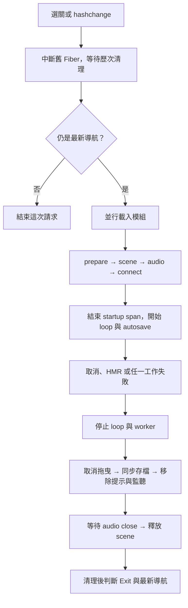

# Effect 架構與維護指南

核對日期：2026-10-24；程式基準 `8a74bce`，依賴固定為 **Effect 4.0.5**。
本文件是九個任務的 Effect 現行規則與差異索引。維護既有關卡或新增關卡前，先讀本文件及 [驗證指南](effect-verification.md)。
Effect 整合的實作、決策與歷次驗證證據保留於 [採用歷史](history/effect-adoption.md)；歷史結果不代替當前版本驗證。一般玩法與呈現變更記在對應關卡設計文件或專項紀錄。

## 使用原則

- Effect 管理瀏覽器副作用、資源生命週期、錯誤、服務組裝與背景工作；domain、幾何、命中判定及逐幀計算保持普通 TypeScript。
- scene／connection 由呼叫端任務 scope 擁有；service 解決同步存檔與音效替換需求，不逐幀查詢 Context 或建立 runtime。
- 正式／開發存檔只接受完整目前版本；舊版本、缺少必要欄位或矛盾狀態開新局，不增加遷移分支。
- 沿用已存在的共用邊界；新增服務或背景工作時，先說明替換需求、所有權、取消及失敗傳播，不以全面包裝狀態為目標。
- API 以 package.json／lockfile 固定版本及已安裝套件型別為準，勿混用 v3 寫法。

### E01～E09 對照

編號保留供歷史、測試與討論引用；全部已接入九關，PWA 與導航為全站共用。

| ID | 現行責任 | 本文件入口 |
| --- | --- | --- |
| E01 | 部分初始化與獨立清理 | [資源與錯誤](#資源與錯誤) |
| E02 | 模組、場景、session、audio close 錯誤分類 | [資源與錯誤](#資源與錯誤) |
| E03 | rAF 排程與動畫失敗監督 | [資源與錯誤](#資源與錯誤) |
| E04 | 手勢音效解鎖與可選降級 | [音效](#音效) |
| E05 | 同步 storage、記憶體優先與診斷 | [存檔與恢復](#存檔與恢復) |
| E06 | 目前版本 Schema 與 domain 不變量 | [存檔與恢復](#存檔與恢復) |
| E07 | persistence／audio 的 Context 與 Layer | [服務與診斷](#服務與診斷) |
| E08 | 並行載入、啟動追蹤與清理後診斷 | [服務與診斷](#服務與診斷) |
| E09 | autosave 監督、導航 Fiber、PWA 有界重試 | [排程與全站工作](#排程與全站工作) |

## 任務生命週期

入口為 [main.ts](../src/main.ts)，導航由 [createNavigation](../src/app/navigation.ts) 管理。

消防在最後存檔後、移除提示前另執行停止水聲；失敗不跳過其他 finalizer。
選單 disposer 也加入導航 scope。快速 A → B → C，即使 B 在等 A 時被取消，C 仍須等 A 清理完。
HMR 透過 `import.meta.hot.data.cleanup` 傳遞導航與 PWA 的清理 Promise。
從選單進入先等舊 scope 最後存檔，再清除所選關卡進度並開新局；重載／HMR 恢復同局，徽章與靜音不隨新局清除。

`startup.ts` 回傳等待中的 `Effect<never, FrameLoopError | AutosaveError>`。
入口在 startup 完成後 `yield* run`，才啟動並監督兩項工作；不要把長時間遊玩包進 startup span。

## 核心行為契約

### 資源與錯誤

共用入口：[scene-lifecycle.ts](../src/runtime/scene-lifecycle.ts)、[cleanup.ts](../src/runtime/cleanup.ts)、
[mission-lifecycle.ts](../src/runtime/mission-lifecycle.ts)、[frame-loop.ts](../src/runtime/frame-loop.ts)。

- renderer 取得後、設定與掛載之前登記 release；scene、陰影、材質快取分別登記，ResizeObserver 在 observe 前登記 disconnect。
- connection 的 AbortController、拖曳提示、最後存檔與 pointer cancel 各自登記；中途失敗仍可回收先前取得的資源。
- 同一 finalizer 的多項同步釋放使用 `releaseAll`：全部嘗試後以 AggregateError 回報。場景遍歷涵蓋 Mesh／Line／Points 並以 Set 去重，包含碼頭 LineSegments。
- `runFrameLoop` 將首次／後續排程及 frame 回呼拋錯轉為 `FrameLoopError`；正常取消也停止 rAF，晚到回呼不再繼續。
- 不額外用內層 scope 包住 prepare／scene／audio／connect 後立即關閉；資源生命週期須覆蓋實際遊玩。

| 錯誤或退出 | 處理方式 |
| --- | --- |
| `ModuleLoadError` | 保留 mission、module、原始 cause；提示重新載入／回選關。 |
| `SceneInitError`、`SessionInitError` | 分類場景或 prepare／connect 拋錯；保留 cause，清理後顯示啟動失敗。 |
| `FrameLoopError`、`AutosaveError` | 保留 mission／cause；停止動畫與存檔工作，清理後顯示對應提示。 |
| `AudioCloseError` | 在 release 嘗試記錄後恢復；diagnostic sink 拋錯也不阻止場景清理。 |
| 純 interruption | 正常取消，安靜結束；不能轉成啟動失敗。 |
| interruption 混合 cleanup defect | 仍是真正失敗，保留完整 Cause；過期任務不得覆蓋新畫面。 |

初始化 wrapper 使用 `catchDefect`，保留取消語意；入口的 `onExit` 在 scope 外，看到的是清理完成後的結果。
不要用廣泛 catch 把所有程式缺陷當成可選功能降級。

### 音效

共用入口：[audio-unlock.ts](../src/runtime/audio-unlock.ts)、[audio.ts](../src/runtime/audio.ts)。

- audio 物件在任務 scope 取得，AudioContext 延後到使用者手勢才建立。
- `createAudioUnlocker` 必須直接在 pointer／click／keyboard 手勢內呼叫，保留同步 unlock；不能先排入背景 Fiber 再 resume。
- 立即觀察 Promise 拒絕，合併 pending 呼叫；同步拋錯／非同步拒絕皆可選降級，後續手勢可重試。
- 使用 connection signal 取消觀察；開發工具模式每個 connection 最多一次解鎖警告，診斷失敗不回拋 DOM handler。
- [消防 sounds.ts](../src/missions/fire-rescue/sounds.ts) 另追蹤水聲 source／filter／gain：部分初始化失敗回滾節點，下一手勢沿用 context 重建；停止／斷開失敗仍嘗試關閉 context，保留所有原因。

### 存檔與恢復

共用入口：[storage.ts](../src/runtime/storage.ts)、[snapshot.ts](../src/runtime/snapshot.ts)、
[progress.ts](../src/app/progress.ts)、[development.ts](../src/app/development.ts)、[mission-persistence.ts](../src/app/mission-persistence.ts)。

- storage getter 與 get／set／remove 都在 `Effect.try` 內；JSON 編解碼另分類。在邊界 `runSync` 前恢復錯誤，沒有 Promise 或儲存重試。
- `StorageUnavailable` 讀取回傳 null，寫入／刪除不阻止遊戲；`SnapshotEncodeError` 不覆寫舊磁碟資料；`SnapshotDecodeError` 標記 json／schema／invariant／resume，無有效快照則開新局。
- 預設 storage 診斷在開發建置依錯誤類別、key 與操作／階段去重，正式建置安靜；直接注入 reporter 拋錯也不破壞 fallback。
- 正式進度先複製到記憶體，再嘗試持久寫入；讀取記憶體優先。清除用 null tombstone 遮蔽刪除失敗留下的舊檔。
- 修路以外八關使用共用開發記憶體 facade；修路優先順序為同 key 的 HMR → 記憶體 → storage。不要把不同生命週期的快照混成單一暫存。
- 除消防外八關保存上一回合／配色摘要，獨立於進度；新記憶體不可被寫入失敗後的舊磁碟摘要覆蓋。
- Schema 位於 persistence adapter，domain 檢查遊戲不變量並解除失效手指／未提交停留，保留部分工作與已載貨物。
- 共用 decoder 依序「目前 Schema → domain resume 原始輸入 → 目前 Schema」；先把原始輸入交給 domain，避免剝除未知鍵後掩蓋精確鍵集合錯誤。修路保留快照 envelope 與調校驗證。
- `structuredClone` 等非預期程式缺陷仍拋錯；不得混成 StorageUnavailable。pagehide、隱藏事件與最後存檔必須保持同步。

正式 key 為 `town-crew:play:v1:<mission-id>`；key 中的版本與快照內的 `version` 是不同契約，不須相等。
修路開發 key 為 `town-crew:road:v2:${location.search}`，其餘為 `town-crew:<開發前綴>:dev:v1:${location.search}`，前綴見下表。
徽章與靜音使用共用 progress facade；上一回合 key 由各關 services 定義（清潔隊為 `last-round:v2`，交通使用 `last-colors:v1`）。

### 服務與診斷

組裝入口為各關 `services.ts`／`startup.ts`；共用追蹤為 [mission-startup.ts](../src/runtime/mission-startup.ts)。

- `*PersistenceLive` 以 `Layer.succeed` 提供模組生命週期的 facade，保留導航／main.ts HMR 之間的快照及上一回合記憶體。測試使用 factory 與隔離 store。
- startup 只解析 persistence 一次，把同步物件傳給 session；`*Audio` 以 `Layer.effect`／`acquireRelease` 取得，每次入關一份，透過 `closeMissionAudio` 釋放。
- 明確以 `Effect.all(..., { concurrency: 'unbounded' })` 並行載入靜態 import 路徑；之後 prepare → scene → audio → connect 依序執行，保留 Vite 懶載入。
- `mission.startup` 包住模組與四個初始化階段，結束後才運行 loop。修路／消防另載 sounds，共七階段；其餘共六階段。
- 每次啟動帶 mission、startupId、mode；開發建置輸出一份 success／failure／cancelled 摘要，正式建置不輸出成功摘要。startupId 跨 main.ts HMR 遞增，整頁重載重設。
- 真正失敗在 scope 清理後 `logError` 一次，附失敗階段；執行期／清理失敗標為 `runtime-or-cleanup`。純取消安靜，摘要／logger／計時器失敗不能替換原始 Exit。
- 時間無法取得或非有限時 durationMs 為 0；平行階段時間不能相加當總耗時。摘要不加入快照、URL 或每幀資料；錯誤 Cause 仍保留原始 stack，沒有遠端 exporter。

### 排程與全站工作

[withAutosave](../src/runtime/autosave.ts) 以 `Schedule.spaced`、`forkScoped`、`Fiber.join` 與 `raceFirst` 共同監督存檔與 loop。
單獨 fork 而不等待無法完成失敗傳播；任一失敗或導航取消都須停止另一項工作，再執行 connection finalizer。

- 首次等待一個間隔，之後每次嘗試完成再等一個間隔，不追補錯過的次數；間隔見下表。
- hidden 跳過定期寫入，但 timer 並非完全暫停。visibilitychange、pagehide、最後存檔與既有手勢／階段 checkpoint 仍同步保存。
- 不在 rAF 裡另設第二份週期存檔時戳。一般 storage 失敗降級；worker 內未處理的失敗轉為 AutosaveError。
- [導航 Fiber](../src/app/navigation.ts) 保留所有先前的清理等待與最新 revision 判斷；不能用 timeout 放棄仍在使用的資源。
- [PWA](../src/app/pwa.ts) 僅在安全來源的正式建置註冊，等待 load（已 complete 則立即開始）；TypeError／NetworkError 最多重試兩次，1 秒、2 秒間隔，總計三次。其他錯誤直接降級。
- PWA 最終只警告一次，診斷失敗不阻擋遊戲；pagehide／HMR 取消 load 等待、backoff 與結果觀察，Workbox 快取／更新策略由原實作管理。

## 各任務差異

下表依九關的 persistence、session、services 與 main 的載入分支核對。關卡名稱連到 persistence，組裝入口連到 startup；同目錄的 scene／session／services 負責各自邊界。
共同規則只在上文定義，新增任務時補表列，不複製整套契約。
九關皆已有 Node 整合與四個手動故障頁入口；各入口用途與實際執行範圍由驗證指南及歷史分別維護。

| 任務／快照 Schema | version | 定期存檔 | 啟動階段 | 開發前綴 | 組裝入口與必要差異 |
| --- | --- | --- | --- | --- | --- |
| [修路](../src/missions/road-repair/persistence.ts) | 1 | 800 ms | 7 | road（特別 key） | [startup](../src/missions/road-repair/startup.ts)；envelope、調校參數、hot.data、貨物所有權與施工順序。 |
| [蓋房子](../src/missions/house-build/persistence.ts) | 6 | 800 ms | 6 | house | [startup](../src/missions/house-build/startup.ts)；屋型／家庭摘要、attached 與部分澆灌／吊裝。 |
| [消防](../src/missions/fire-rescue/persistence.ts) | 1 | 800 ms | 7 | fire | [startup](../src/missions/fire-rescue/startup.ts)；無上一回合隨機摘要，另有持續水聲及停止 finalizer。 |
| [交通](../src/missions/traffic-rescue/persistence.ts) | 3 | 800 ms | 6 | traffic | [startup](../src/missions/traffic-rescue/startup.ts)；上一組雙車顏色、拖吊車型與先後順序。 |
| [警察](../src/missions/police-patrol/persistence.ts) | 3 | 700 ms | 6 | police | [startup](../src/missions/police-patrol/startup.ts)；六項 work 精確鍵集合、三車查驗索引、一般車順序、左右配置、選中重機及含重機／偵防車進場、警員步行與拖吊裝載的自動計時；上一局摘要 key 為 `police:last-round:v3`，不遷移版本 1／2 舊檔。 |
| [碼頭](../src/missions/port-cargo/persistence.ts) | 3 | 700 ms | 6 | port | [startup](../src/missions/port-cargo/startup.ts)；兩方向、懸吊／叉上貨物，scene 含 LineSegments。 |
| [山路](../src/missions/mountain-clearance/persistence.ts) | 3 | 700 ms | 6 | mountain | [startup](../src/missions/mountain-clearance/startup.ts)；workOrder、loaderDocked、部分鏟料與抬升。 |
| [轉運站](../src/missions/passenger-transfer/persistence.ts) | 4 | 700 ms | 6 | transfer | [startup](../src/missions/passenger-transfer/startup.ts)；同行車、部分開門／行駛、行李及自動時鐘。 |
| [清潔隊](../src/missions/sanitation/persistence.ts) | 2 | 700 ms | 6 | sanitation | [startup](../src/missions/sanitation/startup.ts)；接棒次序／回收組合、兩種升桶、空桶／貨物與單向清掃；上一回合 key v2。 |

## 維護與新增關卡清單

### 修改既有關卡

- [ ] 先讀 [關卡設計原則](mission-design.md)、本文件受影響契約與 [按變更選擇驗證](effect-verification.md#按變更選擇驗證)，列明涉及 E01～E09 哪些邊界；純幾何／文案修改可註明無生命週期變更。
- [ ] 核對該關的 scene／session／persistence／services／startup 與共用 helper；改共用 helper 時檢查全部使用者，不能只驗修路。
- [ ] 增加資源、事件或背景工作，同時登記取得、失敗與取消清理；確認不會早關 scope、重複 worker 或略過後續 finalizer。
- [ ] 改狀態欄位時同步更新 domain resume、不變量、目前 Schema、版本政策與 fixture；不以補預設值恢復不完整舊格式。
- [ ] 保持同步 pagehide、記憶體優先、正常取消、原始 cause、音效手勢與懶載入；必要差異寫入上表。
- [ ] 執行受影響測試與必要瀏覽器案例，記錄實際覆蓋／未驗證項目；跨模組或 runtime 變更執行 `npm run check`。

### 設計與新增關卡

- [ ] 在 [新關卡提案](mission-design.md#每個新關卡提案必填) 階段就列出資源、部分進度、輸入取消、可選音效與需要的背景工作，先確定如何沿用本文件契約。
- [ ] 建立該關的 domain、scene、session、persistence、services、startup；一般結構參考清潔隊，特殊持續音效參考消防，只有需要快照 envelope／調校時才參考修路的例外。
- [ ] 登記 `MissionId`、選單與 main 的靜態 lazy 分支；沿用 typed loader、startup span、Context／Layer 與未啟動的 supervised loop。
- [ ] 明確選定存檔版本、獨立 key、上一回合記憶體政策及存檔間隔，補上表列；勿假設所有關卡都有相同回合或音效模型。
- [ ] 將新關加入 [共用整合測試與 fixtures](effect-verification.md#共用測試與任務登記)，涵蓋部分初始化、故障、取消、正式／開發恢復與排程；確保測試 runner 實際收錄。
- [ ] 檢查手動故障頁與瀏覽器測試是否可選新關。需要沿用某套驗證時先補入口／fixture，再執行；缺少入口不得聲稱已通過該套案例。
- [ ] 完成針對該關的實際互動／重載／離場驗證；更新設計清單、必要模型清單、指南與驗證紀錄後才宣稱接入完成。

## 已知限制

- constructor 在回傳資源之前的內部失敗，不是外部 scope 能自動回滾的範圍。
- pointer／click 及 ResizeObserver 回呼不屬於 frame-loop 錯誤邊界；任務 Fiber 不是全域錯誤處理器。
- 中斷不能實際取消瀏覽器原生 import、AudioContext.resume 或 serviceWorker.register；只能取消等待／結果觀察，需驗證晚到結果不再掛載或產生未處理拒絕。
- storage 寫入被拒時，記憶體支援同頁導航與 main.ts HMR，不能保證整頁重載續玩。timer 也可能被節流，間隔不是精準持久化保證。
- BFCache 返回不重新啟動已取消的 PWA 註冊工作，需等新文件載入；已註冊 worker 不會被此清理解除。
- TestClock 不控制 rAF、performance.now 或 Web Audio；Node 故障測試不能代替真實畫面、觸控或可聽音訊驗證。

目前不需要為高頻 pointer／動畫加入 Stream／Queue／PubSub，也不以 Ref／Atom 包裝全部狀態；有實際多訂閱者或背壓需求時再評估。
KeyValueStore 不能直接取代同步記憶體優先與刪除遮蔽契約；沒有帳號／雲端同步或持久工作需求時不引入 Workflow／Cluster。

## 文件維護與來源

- 本文件只維護現行規則、來源入口與任務差異；操作方法與覆蓋清單放 [驗證指南](effect-verification.md)。只有 Effect 整合、E01～E09 契約或其專項驗證的結果追加到 [歷史](history/effect-adoption.md)；一般玩法、動畫、模型、提示或文件整理若沿用既有邊界，結果記在關卡設計文件或專項紀錄，不因引用 Effect 或執行完整測試而追加 Effect 歷史。
- 新增任務、修改資源所有權／錯誤／存檔政策／排程或升級 Effect，在同次變更核對這三份文件；不把「日期更新」當作完成核對。
- README、architecture、PROJECT_PLAN 只保留原則與連結，不另維護一份版本／間隔／測試總數。歷史數字不得隨新關卡增加而改寫。
- 依 [repository 指引](../AGENTS.md) 導讀；若文件與程式不同，核對程式與測試後修正文檔，明確記錄例外，勿僅複製舊範例。

盤點入口可用 `rg -n 'Effect\.|withAutosave|runFrameLoop|createAudioUnlocker' src`；Schema／key／Layer 的核對方法見驗證指南。
若 repository 已有 `.codegraph/`，依 AGENTS.md 先使用 CodeGraph；沒有索引時不自動建立。
API 參考：[Effect v4](https://effect.website/docs/v4/api/effect)、[Scope](https://effect.website/docs/v4/api/effect/Scope)、[Schema](https://effect.website/docs/v4/api/effect/Schema)、[Context](https://effect.website/docs/v4/api/effect/Context)、[Layer](https://effect.website/docs/v4/api/effect/Layer)、[Schedule](https://effect.website/docs/v4/api/effect/Schedule)、[TestClock](https://effect.website/docs/v4/api/effect/testing/TestClock)。
